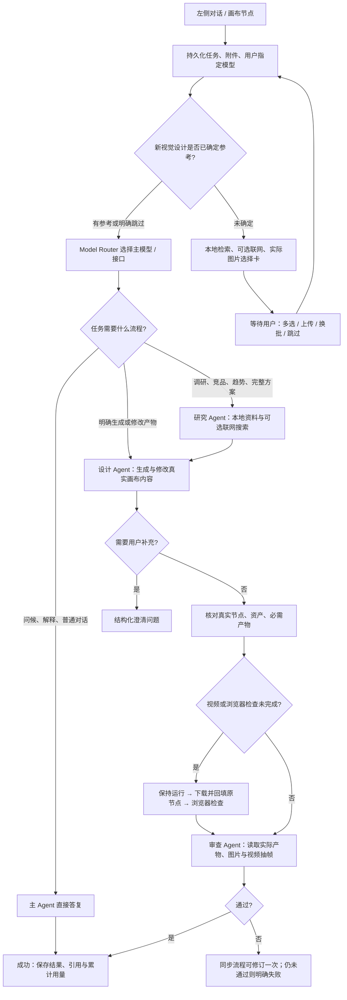

# Agent 执行与媒体交付

## 当前路径

所有 Agent 使用项目已有的 OpenAI Agents SDK 与同一任务。研究和审查注册读取工具与公开执行说明工具；设计 Agent 注册生成、画布修改、连线和按需扩展工具。研究简报等待完成后才传给设计 Agent；首页不再另行启动与首轮任务竞争的后台检索。`review.passed=false`、无效审查 JSON、必需产物缺失或浏览器检查失败都不能标记为成功。后台检查发现 HTML/文本问题时，允许一次针对原节点的修复，再重新验收；其他情况恢复最终审查，不重新执行研究或收费生成。最终审查失败会明确结束为失败，保留真实成果与问题清单。研究与审查可以在设置中分别选择模型，留空沿用主模型；用户手动指定模型时不替换角色模型。

普通问候自动选择 FAST，直接由主 Agent 答复，不经过三阶段流程，也不推进旧版固定工作流。文本等级与执行阶段独立决定：指定手动模型不取消产物检查，直接流程中实际生成了产物仍会进入交付检查和审查（显式关闭协作除外）。允许联网时，涉及事实、最新趋势、竞品等的研究由 `web_search` 委托 OpenAI Agents SDK 搜索 Agent，默认经 OpenRouter Responses 的 `openrouter:web_search` 服务端工具检索（优先 native 引擎），来源以真实 URL 展示。开关关闭时工具不可调用，服务端也检查任务配置。

`task_policy.py` 从用户生成意图、画布节点类型和显式 `requiredArtifacts` 合并交付要求，覆盖照片/图像、视频、音频、HTML 与文本节点。`deliveryContract` 进一步校验最少数量、图像尺寸、文件格式和透明通道；支持结构化要求，并从明确的文字规格推断常见要求。复杂布局、语义与设计质量仍由审查 Agent 判断。定时计划管理不会要求立即交付未来产物；到期运行带 `scheduledTask` 标记，仍按实际生成任务验收。

## 视觉参考准备

新的视觉设计默认在付费生成前选择参考。主设计角色发起 `request_reference_selection`，设计/研究角色可调用 `reference_search` 和 `reference_inspect`。任务和批量生成工具均校验选择状态；参考卡不进入交付补全、修复或验收。所选图片复制到项目资产，图片 ID 和借鉴要点写入设计状态与生成快照。详细行为见 [本地视觉参考库](visual-reference-library.md)。

## 原生图片输入

上传图片、引用图片和节点参考图片通过 SDK `input_image` 传入；文本资料独立输入，不再把 base64 截断后塞入附件摘要。文档与网页内容作为资料，不能覆盖用户和系统指令。目录明确表示不支持图片输入的模型会返回说明或进入已配置的备用服务路径。

Chat Completions 不支持图片工具结果时，会将工具返回图片转换为紧随结果的原生用户图片消息，避免 SDK 丢弃视觉内容。

## 引用与修改范围

本轮明确引用优先于历史上下文。前端保留引用的资产 ID 和具体节点 ID；后端从当前项目存储读取最新内容，不信任前端携带的旧节点正文。引用图片携带原生视觉内容与资产 ID，上传图片也获得可用于后续编辑的资产 ID；输入素材不算本轮新交付。

有引用时只向模型提供相关节点及附件；引用不存在时明确记录缺失，不自动换成其他节点。附件编号与具体画布位置随请求保留；明确引用部分附件时仅发送选中的附件，删除的引用不会从旧选择状态重新带入。历史资料文件按全局文档 ID 读取原文件；跨项目图片在本项目保存可编辑的输入副本，原始素材保持不变。

没有引用时先提供最近对话中的产物或曾讨论的引用，包括上一轮节点编辑回执；不依赖“修改/调整”等关键词来判断是否需要上下文。“再简洁一点”也能接续已有对象。多个历史对象只提供标题、位置和 ID，由 Agent 结合话语选择后精读；不会自动把全部候选正文和图片载入。较早目标可通过 `conversation_read` 定向回查，回查得到的真实 ID 随任务记录，后续可按 ID 读取。无需默认遍历画布或检索资料库。

`canvas_read` 默认读取当前引用或上下文目标，支持节点/资产 ID 与长正文续读；`scope=outputs` 只包含本轮实际改动，即使传入其他 ID 也不能扩大范围。引用范围检查同样用于按 ID 读取、素材检查、节点修改和导出。有明确引用时禁止目录遍历，素材搜索即使带关键词也限制在相关内容。没有引用且上下文不足时，必须提供具体标题 query 才返回少量目录；不允许无关键词或逐页遍历，探索候选总数限制为 12 个。用户明确要求全画布操作时才放开；“不要遍历整个画布”不会被误判为允许。

画布修改工具返回改动节点与边，完整画布只保留在 UI 请求中，不进入 Agent 工具回执。恢复旧任务时也会去除工具结果中的旧全画布快照，保留已有生成回执和具体成果，避免恢复过程再次带入无关内容。

生成与编辑工具显式声明 `canvas_node_id` 和 `output_mode`。Agent 先区分待调整图像、风格参考和文字约束；图片调整把旧节点的资产作为 `source_asset_id`，使用 `output_mode=create` 在新节点生成，旧图始终留在画布。即使模型误传旧图的 `canvas_node_id` 和 `output_mode=edit`，服务端也会转换为非破坏式新建；系统交付修复同样保留旧图。只有不含图像的空白待生成节点会被直接填充。其他类型内容仍按语义选择原位修改或基于参考新建。服务端不按关键词或引用数量猜测目标；同一调用重试复用原始参数对应的回执，不会重复生成。审查只读取本轮产物及其直接引用，已预取的图像/视频和节点内容不要求重复读取。

图像资产默认作为可继续生产使用的干净成品：尺寸、材质、工艺等信息缺失时不得在图片中加入“概念示意”“仅供参考”“参数待确认”“尺寸待定”等系统角标、水印、注释或占位文字。`generate_image.production_notes` 保存最多 8 条图片外制作说明，随资产和节点持久化，并在节点底部显示；原始图像导出不包含这些说明。工具层在发送任何图像 Provider 前统一追加生产边界和负面提示，批量生成同样适用。只有用户明确要求的信息图、带标注效果图、工程标注图及正式设计文案可以进入图片。总览审查把未经要求的概念免责声明判为内容错误，节点外 `productionNotes` 不算图像缺陷。

## 运行说明与流式收尾

执行过程显示用户可见的行动说明与简短判断摘要。Agent 可通过 `report_progress` 说明当前目标、引用依据或方案变化（每次最多 400 字、每次 worker 执行最多 6 次）；工具开始和阶段切换补充真实操作状态。界面不读取原始 reasoning 或内部逐步推理。

每次模型响应结束，用 SDK 的完整响应补齐增量文字，并在阶段结束用最终输出再次对齐。工具调用前的公开说明单独保留；不同模型响应的增量分别累计，避免混接。响应中断时保存已有片段并记录中断状态，不把未完成内容当作成功答复。

Chat 的 `finish_reason=length` 或缺失结束状态会在 SDK 接受结果、执行工具之前被拦截，保留已有文字与已发生的用量，明确提示输出未完成。此类情况不会自动反复调用模型；达到长度上限时可在设置提高单次输出上限，或缩小本轮需求。Responses 的异常结束状态由 SDK 拒绝并进入同一中断展示路径。

进度存储独立保留最新正文、最近 24 条行动说明及最近 80 条其他事件；正文不再被原先的 1,000 字上限截断（流式缓存最多 64,000 字，完整终稿仍存任务结果）。并发事件更新使用事务，前端遇到暂缺正文的轮询快照保留已有文字；失败与停止后可展开执行记录查看中断前的内容。

回归测试包含真实 SDK 的 Responses 半句增量/完整终帧、Chat 快速连续增量、工具切换、异常终止、原生引用输入与定向修改/审查；传输层使用本地模拟，不调用收费模型。

`asset_inspect` 可在生成后读取当前项目的 PNG/JPEG/WebP/GIF 图片，返回原生视觉工具结果，供设计和审查继续使用。单张直接输入上限 8 MB；附件总量上限 20 MB、数量 8 个。大文件和不可直接查看的格式只提供解析内容或元数据，并说明未作视觉细节检查。

## 工具与内容类型

| 内容 | 执行能力 |
| --- | --- |
| 文本、文案、代码 | 主 Agent 写入 `canvas_create_text`；也可 `generate_text` 指定本地目录中的其他文本模型 |
| 图像、参考图编辑 | `generate_image`；OpenRouter `/images`，普通中转站 Images API，CloseAI Gemini 原生接口 |
| 音频、语音 | `generate_audio`；TTS `/audio/speech`，支持音频输出的 Chat 模型使用音频消息；OpenRouter 音频按 SSE 拼接并保存 MP3 |
| 视频 | `generate_video`；OpenRouter `/videos` 提交与状态查询，兼容现有视频服务适配器 |
| HTML 网页、交互演示 | `canvas_create_html` 创建或更新 iframe 节点，支持完整内联 HTML/CSS/JS |
| 工作流连线 | `canvas_link_nodes` 已注册到 SDK；`canvas_read` 读取节点、连线、源码和媒体状态 |
| 模型选择 | `list_models` 读取设置同步到本地的目录，按实际内容类型选择 |
| 定时计划 | `schedule_list/create/update` 查询、创建、修改、暂停和删除本项目计划，到期沿用现有执行与通知链路 |
| 网页精读 | `web_read` 保存全文快照、来源和抓取时间，分页读取；时效性研究可主动刷新 |
| 图像编辑 | `image_edit` 裁剪、缩放、透明扩边、转换格式、带遮罩局部重绘；保留原资产 |
| 音视频后期 | `media_edit` 本地 FFmpeg 裁剪、拼接、替换配音和写入可切换字幕轨 |
| 音频转写 | `transcribe_audio` 使用本地目录中已同步的转写模型和真实文件，保存文字节点，不猜测缺失时间戳 |
| 正式导出 | `export_deliverable` 生成 HTML/PDF/PPTX/ZIP 可下载文件，不依赖旧报告流程 |
| 节点历史 | `canvas_versions` 查看历史与差异；`canvas_restore_node` 恢复指定节点内容，保留其他节点与位置 |

3D 和 CAD 本轮不扩展。代码类交付支持源码、网页和前端交互演示，不包含任意服务器命令执行或应用发布。音频接口不能仅凭模型名称宣称音乐生成能力。

OpenRouter 的模型目录在设置同步时读取 `/models` 以及专用 `/images/models`、`/videos/models`，合并 API 确认的 ID 后保存本地。不会从首页发起模型发现，也不会凭空补入默认模型。模型实际权限取决于账户和中转站。

文本节点和 HTML 节点明确选择模型后，前后端都将其视为手动选择；全局自动路由不会覆盖节点模型。

## 节点尺寸

- 图像、视频、音频、文本、HTML、上传占位、文档和已有 3D 节点均提供右下角尺寸手柄；可拖动或用方向键微调（Shift 加速）。尺寸按画布坐标计算，拖动时不触发视图自动缩放；松手、失去指针捕获或窗口失焦时结束调整。
- 统一保存 `data.previewSize`，接入画布撤销/重做；旧网页的 `htmlPreviewSize` 仍可读取。重新加载或替换内容保留手动尺寸，锁定或正在上传的节点不能调整。连接点、整理布局、自动放置和项目缩略图都读取节点尺寸。
- 图片和视频等比容纳于预览框，文本保持字体大小、自动换行并允许滚动；音频控件和 3D 预览随框变化。各内容类型有最小可用尺寸，上限为 1920 × 1440；网页的逻辑视口另按下文比例计算。
- `npm run test:node-resize` 使用本地媒体和真实 Chromium 鼠标事件验证各类节点调整、松手停止、连接点和连线路径、内容显示、尺寸保存、撤销/重做、键盘调整及锁定保护，不调用模型。

## HTML 节点

- 双击画布或点击添加，选择「网页 HTML」。也可直接在左侧输入网页需求。
- 选中节点后可选择文本模型并提出修改；修改针对原节点。
- 节点提供「源码」编辑、保存和「导出 HTML」。上传 `.html` 也可直接预览。
- 网页预览默认以 960 × 640 的画布尺寸展示 1440 × 960 桌面视口；画布缩放不改变网页断点。右下角可拖动调整尺寸（也支持方向键），尺寸会保存并参与撤销。用户调整节点尺寸后，iframe 视口随之改变，网页自身的媒体查询负责响应式布局。
- 拖动节点期间临时关闭 iframe 的鼠标命中，松手后恢复；网页内部保持滚动、按钮等交互。网页容器、连接点与自动放置使用一致的实际尺寸。
- `npm run test:html-canvas` 使用真实 Vue Flow 与 Chromium 鼠标事件回归快速跨 iframe 拖动、松手后停止移动、按钮点击、滚动、画布缩放、节点缩放/保存与连接点位置；生成和存储使用本地测试数据，不调用收费模型。
- 预览使用 `srcdoc`、`sandbox="allow-scripts"` 和置于文档最前方的 CSP。脚本可以在 iframe 内交互，不能读取父页面、调用应用接口、访问网络、载入外部脚本、提交表单或嵌套其他页面。
- Agent 按本轮引用、对话与当前产物判断哪些图像适合网页；不用全画布遍历，也不自动塞入所有图片。HTML 的 `img src` 或 CSS `url()` 可使用 `asset://真实资产ID`。服务端检查项目归属与引用范围，把本地 PNG/JPEG/WebP/GIF 快照保存在 `htmlAssets`；预览、浏览器验收与 HTML/ZIP 导出解析为 data URL。工具回执和正文读取只返回源码及 `imageAssetIds`，不把整段图片数据塞进模型上下文。最多 12 张、单图 8 MB、合计 16 MB。
- 新插图先通过 `generate_image(background=transparent)` 生成并校验透明通道，再引用真实资产；不要用 SVG 绘制插图替代。已有相关照片可保留背景。透明要求未满足时必须说明，不能伪称成功或自动反复收费生成。
- 网页需自包含，字体等可内嵌为 data URL。需要外部接口的完整站点仍需另行配置和部署。
- 交付前在独立沙箱 iframe 检查内容、脚本异常、未处理的 Promise 异常、CSP 拦截，并尝试最多 6 个按钮。验收结果绑定 HTML 内容指纹，修改后必须重新检查；不会把旧版检查结果当成新版通过。

## 浏览器验收边界

图像由服务端检查文件存在、解码、尺寸与透明通道；HTML、音频和视频由工作区后台浏览器自动验收。桌面版启动独立隐藏 Chromium 窗口，无需打开对应项目；网页版由打开的应用页面消费同一队列。音频实际解码并检查时长；视频实际解码并提取最多 3 帧供审查 Agent 查看。审查开始和结束都会重新核对产物指纹，期间变更会使旧审查失效。

浏览器每批最多领取 2 个检查，结果保存在 `delivery_checks`；`delivery_leases` 防止重复领取，进程中断后 90 秒租约到期可接续。应用完全退出时检查等待，下次启动继续。按钮抽查不等于完整业务测试，视频抽帧不等于逐帧检查，音频解码不等于内容试听；这些边界会保留在审查上下文中。

## 视频完成与恢复

视频任务编号仅表示已提交。任务保持运行状态，后台每次查询结果后保存到 `video_jobs`；成功下载后记录本地资产，进入 `backfilling` 状态，再填回原节点并记录 `canvasSynced`。画布写入失败会重试同一资产和原节点，不会因为已有 `outputAssetId` 就跳过恢复。多个视频都完成、浏览器检查通过、最终审查通过后，任务才成功。失败原因显示在画布与任务中。普通文生视频查询不需要 IP 档案和源图片。

后台在服务启动后自动恢复；临时网络/下载错误按退避间隔重试。超过 24 小时仍无可用结果则明确失败，可在核对供应商后手动刷新恢复。手动刷新与自动查询共用锁和回填实现；已有输出资产会复用。下载后、更新任务记录前中断，也可通过资产的任务标记找回结果。

视频等待阶段重启不会重新调用 Agent、分类模型或提交生成请求。关闭应用期间不会执行本地轮询；下次启动继续查询供应商已有任务。停止 Agent 只停止对话任务，不能承诺取消供应商已经接受的计费任务。

## 持久化与重复调用边界

- `agent_checkpoints` 保存阶段结果、会话和已完成工具结果。图片二进制不重复写入每个阶段，恢复时重新读取附件或资产。
- `tool_receipts` 在工具开始前记录调用，在 HTTP 返回前保存结果；相同任务、工具名和参数的成功调用直接复用。只读查询仍获取最新内容。
- 资产、视频任务、文本/HTML 节点和画布操作保存任务 ID 与调用指纹。重启后如果实际内容已保存而回执尚未提交，会从这些记录恢复回执；不会重复生成或创建节点。主 Agent 断线时，已经接受的视频任务与已落盘的成果继续保留在交付等待流程中。
- 参数校验未通过或接口明确拒绝的请求允许修正后重试。
- 在提交付费生成后断线、且本地还没有收到可核对的返回时，状态保留为未确认，禁止自动重发，也禁止在同一任务中改写提示词绕过该检查。用户需先核对供应商任务，再决定是否发起新任务。
- 这避免了盲目重复扣费，但不声称数据库与第三方付费接口之间存在跨系统事务或绝对 exactly-once 保证。

各 Agent 阶段独立记录实际用量，最终结果累计研究、设计、修订和审查用量，恢复后继续累计；视频以供应商任务 ID 去重结算。继续采用「1 元 = 100 积分，倍率 1」，未知单价或用量保留待计费。

设置可启用默认单任务积分预算。新请求前按已知价格和估算用量预留积分，返回实际费用后结算；视频异步完成更新原预留。价格或单位未知时暂停新收费调用，已提交任务仍可查询与回填。估算不是供应商账单的绝对上限，超出预估后会阻止后续调用。读取工具并发上限可设 1–4，画布写入和生成提交依次执行，尚未实现完整任务 DAG。

新增能力、限制与验证记录见 [本轮优化说明](AGENT_OPTIMIZATION_2026-09-12.md)。

## 验证与接口依据

使用真实已安装 SDK、模拟上游传输及真实 SQLite/画布存储，覆盖 Responses 与 Chat 的原生视觉输入、研究等待、审查修订、HTML 保存、模型覆盖、视频回填/失败、重启复用、音频流和媒体协议。不需要调用收费模型。

协议依据：[OpenRouter Image API](https://openrouter.ai/docs/guides/overview/multimodal/image-generation)、[Video API](https://openrouter.ai/docs/guides/overview/multimodal/video-generation)、[Audio](https://openrouter.ai/docs/guides/overview/multimodal/audio)、[OpenAI Agents SDK](https://openai.github.io/openai-agents-js/guides/agents/)。

真实浏览器回归入口为 `npm run test:delivery-preview`，使用 Electron 内置 Chromium 运行生产验收代码，覆盖正常按钮、脚本报错、外部脚本被拦截、空网页、有效音频、有效视频抽帧与损坏视频。后端测试包含真实 SDK 的 HTML 等待检查、仅恢复最终审查、审查失败和中断回执恢复。

本轮只修改源码，不重新打包或更新安装应用。以上不替代真实账户模型权限、收费生成和所有业务场景的人工验收。
