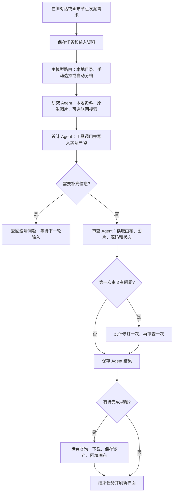

当前 Agent 流程与产物交付排查（2026-09-11）

> 本文保留排查时的历史结论。2026-09-12 的修复与验证结果见 [流程修复记录](AGENT_FLOW_FIXES_2026-09-12.md)，当前执行路径见 [Agent 执行与媒体交付](AGENT_EXECUTION.md)。

当前链路已经实现研究、设计、审查、工具执行和画布保存，但还不能认定交付顺畅。实际记录中，最新绘图请求在研究阶段遇到接口兼容错误；隔离复现还确认了“审查不通过仍成功”和“视频文件已保存、原节点仍生成中”两类状态不一致。

本次检查的是当前工作区源码和正在运行的 Vite / Uvicorn 开发服务。服务健康检查通过，API 项目 ID 与 `services/api/workspace-data/catalog.sqlite` 中的项目一致。本次没有调用收费模型，没有修改业务源码或重新打包；不代表已安装桌面包同步更新。

**当前执行路径**

研究结束后才交给设计；研究、设计和审查是顺序执行的专职角色，在一次路由尝试中使用同一个主模型。默认每轮都会启动研究和设计，无澄清问题时再启动审查；第一次审查明确列出问题时，增加一次修订和复审。因此通常为 3 个阶段，最多 5 个阶段，并非根据需求动态选择专家的并行调度。

输入图片已经可以作为原生视觉消息传入，生成后的图片可由 `asset_inspect` 读取。允许联网时，研究角色可以调用基于 Responses 的 `web_search`，实际是否调用由模型遵循提示词决定；不是每次任务无条件搜索。模型目录从设置同步的本地数据读取，媒体模型由独立媒体路由选择。文本和 HTML 节点明确选定模型时，会覆盖全局自动路由。

前端通过任务事件流跟踪状态，断流后有查询回退，同时约每 1.2 秒刷新画布。任务和工具执行回执持久化；已完成且参数相同的工具结果可以在重启后复用。付费请求结果不明时会阻止自动重发，需要核对供应商结果。

入口与协作依据：[App.vue](/Users/alexi/Documents/AI/codex/codexProject/AICultureCreativeStudio/apps/renderer/src/App.vue:3444)、[openai_agent_worker.mjs](/Users/alexi/Documents/AI/codex/codexProject/AICultureCreativeStudio/services/api/app/openai_agent_worker.mjs:433)、[execution_store.py](/Users/alexi/Documents/AI/codex/codexProject/AICultureCreativeStudio/services/api/app/execution_store.py:24)。

**各类产物怎样交付**

| 产物 | 当前保存与展示路径 | 当前验收边界 |
| --- | --- | --- |
| 对话答复 | 保存任务结果，显示在左侧 | 一段成功答复不等于用户要求的设计产物已经生成 |
| 文本、代码 | 直接写文本节点，或调用指定文本模型后写节点 | 代码支持源码交付，没有任意工程构建或服务器执行环境 |
| 图像 | 生成接口返回字节 → 本地资产 → 图像节点 → 审查可读取真实图片 | 现有 6 个 Agent 图像文件均存在且可解码；新绘图请求当前仍被主模型接口错误阻断 |
| 音频 | 音频模型或 TTS 返回字节 → 本地 MP3 资产 → 播放节点 | 已有模拟接口验证；不能据此承诺所有音乐模型、所有音频任务都支持，也没有自动听音验收 |
| 视频 | 提交 Job → 持续查询 → 下载 → 本地视频资产 → 原节点回填 → 结束任务 | 正常路径已由隔离测试覆盖；完成后没有再次审查实际视频，回填失败有恢复漏洞 |
| HTML 网页 | 写入画布节点 `data.html` → iframe 预览 → 编辑或导出 HTML | 自包含 HTML/CSS/JS；外部网络、脚本、字体、图片及接口受 CSP 限制；未自动运行浏览器验收交互 |
| 画布连线 | 工具或界面保存节点间的边，节点生成可使用上游参考 | 连线不等于自动执行整张依赖图 |

媒体是本地资产，文本和 HTML 主要保存在 `canvas/board.json`。产物在工具执行过程中就会出现，并非全部等到审查通过后再发布。审查当前是只读模型检查，不能替代浏览器交互、视频播放或音频内容验收。

依据：[design_tools.py](/Users/alexi/Documents/AI/codex/codexProject/AICultureCreativeStudio/services/api/app/design_tools.py:267)、[htmlPreview.ts](/Users/alexi/Documents/AI/codex/codexProject/AICultureCreativeStudio/apps/renderer/src/htmlPreview.ts:3)、[GeneralCanvasNode.vue](/Users/alexi/Documents/AI/codex/codexProject/AICultureCreativeStudio/apps/renderer/src/components/GeneralCanvasNode.vue:89)。

**已确认的问题，按处理优先级排列**

| 优先级 | 问题与证据 | 对用户的影响 |
| --- | --- | --- |
| P1 | 2026-09-11 23:28:51 的“画一只小狗的照片”任务，经过 FAST / STANDARD / REASONING 的 6 次执行尝试，最终因 `gpt-5.6-sol` 的 Chat Completions 工具 + reasoning 参数组合返回 400。兼容逻辑只为 GPT-6 自动切 Responses 或在 Chat 下关闭推理。 | 图像工具还没执行，整个生成请求就失败。升级模型等级不能修复这种接口参数冲突。 |
| P1 | 使用真实 Agents SDK 和模拟上游让两次审查均返回 `passed: false`，最终任务结果仍是 `status: succeeded`，只有警告文本。 | “已完成”无法代表审查合格。 |
| P1 | 产物校验主要依赖 `task_type` 的 `media:` 前缀或外部 `requiredArtifacts`。实际绘图请求的分类器返回了 `image_generation` / `image_generator`，没有归一化到当前约定；HTML、音频和手动路由也缺少统一的必需产物约束。隔离构造无产物、审查失败的成功答复，校验函数仍放行。 | 可能只答复文字、没有交付请求的节点，仍显示成功。该次真实绘图在接口阶段已失败，因此实际记录尚未走到这项校验。 |
| P1 | 模拟视频文件保存后的一次画布写入失败：Job 和任务均成功，原节点仍 `generating: true` 且无资产。下一次后台轮询不再处理该 Job；后续 GET 画布的资产补全创建了第二个节点，保留原生成中节点。 | 用户看到旧节点一直转圈，同时另有一个视频成品节点；状态和交付位置不一致。 |
| P2 | 视频审查发生在异步视频完成前；下载成功后由后台直接结束任务，没有再次调用审查角色。 | 可以确认文件已保存，不能确认视频实际符合需求或可正常播放。 |
| P2 | SDK 结果未从工具产物建立统一 `artifact_refs`；Python 只保留工具数量，不保留完整工具结果。已复现 HTML 节点存在、任务的产物引用仍为空；异步视频有单独补引用。 | 画布仍能展示产物，但任务级交付清单不完整，后续追溯和验收需要重新查画布或资产。不能直接从任务结果得出完整交付清单。 |
| P2 | 默认简单对话也走三阶段。实际“你好”最终使用 PREMIUM / `gpt-6-astra`，成功阶段产生 4 次模型请求，整体约 30.07 秒。任务成功还调用旧工作流推进接口。 | 简单交流等待和积分开销偏大，工作流进度可能被普通聊天或澄清答复推进。 |
| P2 | 已提交但未确认的付费工具调用会阻止重发，这是正确的防重复策略，但缺少把供应商 Job、已保存资产和未完成回执自动对账的完整恢复流程。 | 某些重启或断线边界仍需人工核对；不能承诺所有中断均自动续完。 |

问题定位：[接口选择](/Users/alexi/Documents/AI/codex/codexProject/AICultureCreativeStudio/services/api/app/openai_agent_worker.mjs:49)、[审查与成功状态](/Users/alexi/Documents/AI/codex/codexProject/AICultureCreativeStudio/services/api/app/openai_agent_worker.mjs:449)、[产物校验](/Users/alexi/Documents/AI/codex/codexProject/AICultureCreativeStudio/services/api/app/model_router.py:135)、[必需产物推导](/Users/alexi/Documents/AI/codex/codexProject/AICultureCreativeStudio/services/api/app/model_router.py:210)、[视频保存与回填顺序](/Users/alexi/Documents/AI/codex/codexProject/AICultureCreativeStudio/services/api/app/video.py:91)、[视频结束任务](/Users/alexi/Documents/AI/codex/codexProject/AICultureCreativeStudio/services/api/app/video.py:102)、[任务产物转换](/Users/alexi/Documents/AI/codex/codexProject/AICultureCreativeStudio/services/api/app/design_runtime.py:292)、[成功后推进工作流](/Users/alexi/Documents/AI/codex/codexProject/AICultureCreativeStudio/services/api/app/task_runtime.py:355)。

建议修改顺序是：先解决主模型接口兼容；再统一“任务成功”的条件和必需产物清单；随后修复视频回填的重试与对账，并把实际产物验收放在视频完成后；最后优化简单对话路由和任务级产物索引。

**本次验证结果**

- 后端：171 项通过，2 项失败。失败项为 `test_image_transparency.py` 的两项文件 MIME 断言：全局测试模式默认选中 `local-placeholder`，把模拟返回的 PNG/JPEG 保存为 SVG 扩展名。保持模拟 Provider、关闭测试模式后，两项验证通过。因此当前证据指向测试夹具与默认 Provider 的冲突，不能据此宣称真实图片交付普遍损坏。
- 前端：23 项通过；TypeScript 检查通过。
- 新增隔离诊断：两次审查失败仍成功、无产物校验放行、视频回填异常和后续重复节点均已复现；没有修改正式测试或业务文件。
- 实际运行数据：检查了当前服务对应的任务记录；6 个标记为 Agent 生成的图片资产存在且成功解码。当前库未提供新协作链路下音频、HTML 或视频成功交付的真实账户验收证据。
- 本次未做真实收费生成、浏览器交互验收或桌面重新打包。诊断脚本使用临时目录及模拟接口，未改写用户任务或画布。
