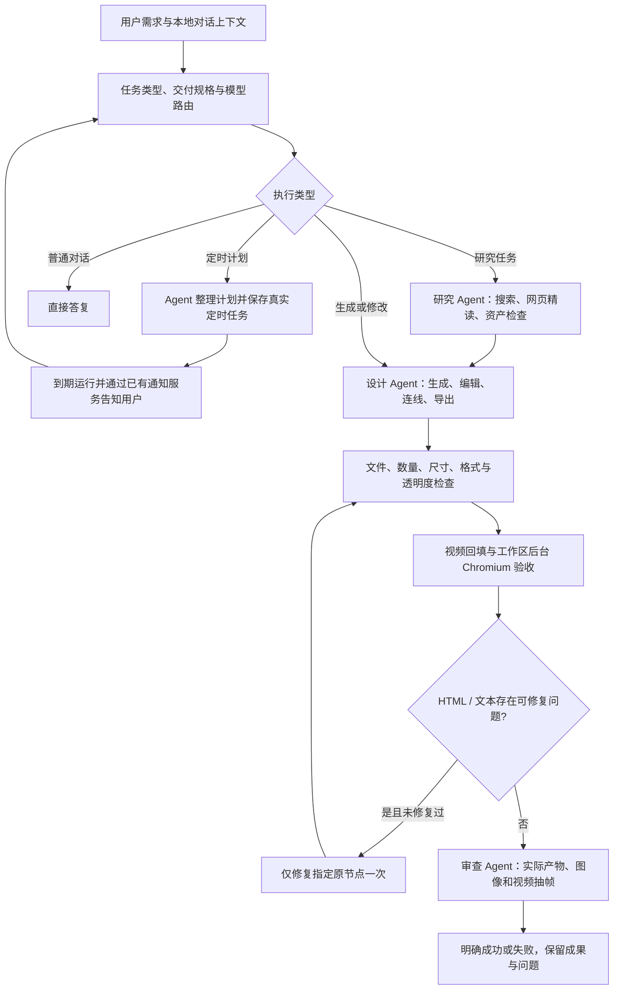

# Agent 优化与验收记录

本轮在现有项目中完成源码、配置界面和回归测试更新；没有执行构建、重新打包或替换已安装应用，也没有向用户的中转站提交收费生成请求。

## 当前执行路径

定时计划中的未来生成要求不会被当成立即交付要求；带 `scheduledTask` 的到期运行仍执行实际产物检查。修复路径服务端限制目标节点和工具，禁止借修复新建产物或提交新的收费生成。

## 新增工具

| 工具 | 实际行为 |
| --- | --- |
| `schedule_list/create/update` | 查询本项目计划，创建或修改计划，暂停、恢复、删除；创建使用任务及调用指纹去重 |
| `web_read` | 抓取公开网页正文，保存来源、时间、快照，按 12,000 字符分页；第一页可刷新。关闭联网时服务端拒绝 |
| `image_edit` | 本地裁剪、缩放、透明扩边、PNG/JPEG/WebP 转换；带 Alpha 遮罩的局部重绘交给配置中的图像服务，保留原资产 |
| `media_edit` | 本地 FFmpeg 裁剪、同类型拼接、替换配音、写入字幕轨；限制输入数量、处理时间和执行时长 |
| `transcribe_audio` | 从已同步目录选择转写模型，提交真实音视频文件到 `/audio/transcriptions`，保存文字节点及供应商返回的时间戳 |
| `export_deliverable` | 将当前节点导出为 HTML、PDF、PPTX 或 ZIP 并写入可下载节点；PPTX 可以提供结构化分页内容 |
| `canvas_versions` | 查看节点历史快照与内容差异，重启后仍可查询 |
| `canvas_restore_node` | 仅替换指定节点内容，保留位置、连线和其他节点；拒绝恢复正在生成的节点或中间版本 |

工具按需求加入主 Agent，研究、审查继续使用读取工具。没有加入任意 Shell 执行、3D 或 CAD 新能力。

## 设置与调度

在「设置 → 路由与积分 → 研究与审查模型」中可配置：

- 研究、审查的独立模型、服务和协议。留空沿用主模型，用户手动指定模型时保留该选择；记账使用各阶段实际模型。
- 读取工具并发上限 1–4，默认 2；生成提交与画布写入依次执行。
- 默认单任务积分预算，留空不限制；单次最大输出长度默认 4096。

开启预算后，新模型请求先预留积分，再按实际费用或用量结算。未知价格或计费单位会阻止新收费请求；收费是否发生不明时保留预留。视频提交后仍允许查询，最终账单更新原预留，不重复占用。预估基于本地价格与输入/输出估计，不能承诺供应商最终账单绝不超出预算；实际超出后会阻止后续请求。默认积分规则保持 **1 元 = 100 积分，倍率 1**。

自动模式下，服务连续 3 次临时失败后冷却 60 秒，优先同档位备用服务。启用预算时还比较同档位已配置服务的预计成本，优先已知价格更低且健康的服务。没有实时抓价、自动测延迟或更换用户手动模型。

## 后台验收与版本

桌面应用增加独立隐藏浏览器来处理整个工作区的验收队列。切换项目或关闭项目页面不再阻塞检查。网页版由打开的应用页面消费队列；应用进程完全退出后等待下次启动。

每批最多领取 2 个节点，以内容指纹和 90 秒租约处理并发及进程中断。视频下载回填后检查真实解码和抽帧；HTML 检查可见正文、脚本异常、CSP 和最多 6 个按钮。修改后旧检查不再有效。

交付契约支持内容类型、最少数量、图像尺寸、格式、透明度；常见明确文字规格会自动提取，也支持结构化 `deliveryContract`。复杂布局、设计风格和语义质量仍依赖审查模型。

节点版本和调用回执保存在本地数据库。已成功工具复用结果；收费请求响应不明时不会盲目重发。版本历史目前没有自动清理策略。

## 能力边界

- 图像 `extend` 是透明扩边；AI 补画需要明确遮罩和支持该能力的服务。局部重绘的上游支持不能仅凭模型名保证。
- 音视频处理单次最多 600 秒，拼接最多 12 个素材；字幕为可切换字幕轨，未实现烧录字幕和浏览器字幕轨切换界面。
- 转写文件不超过 25 MB；当前支持目录中名称可识别的 transcription/Whisper 模型，仍需中转站实际支持转写接口。没有时间戳时不猜测字幕时间。
- PDF/PPTX 导出正文与图片，网页正文提取不等于复刻网页视觉布局。HTML/ZIP 保留媒体，单网页 HTML 保留原源码与交互。历史导出节点默认不再次打包。
- 网页精读适用于可直接抓取的公开正文；登录页、需要浏览器执行的动态正文及二进制文档不会伪装为已读。资料中的指令不能覆盖用户任务。
- 只读工具可以有限并发，整个研究、设计、审查链仍按依赖顺序运行，未实现完整任务 DAG。后台修复最多一次，不无限重试。
- 浏览器按钮抽查、视频抽帧和音频解码不等于完整业务测试、逐帧审查或内容试听。

## 已执行验证

- 后端完整测试：**249 项通过**。
- 前端测试：**33 项通过**；前端与桌面端 TypeScript 类型检查通过。
- Chromium 验收：**8 项通过**，包含正常/异常/空 HTML、外部资源拦截、有效音频、视频抽帧、损坏视频，以及无项目页面情况下消费两个项目的队列。
- 真实已安装 Agents SDK + 模拟上游传输：验证研究/设计/审查的独立模型与实际记账、逐调用预算预留/结算、HTML 原节点修复后重新验收，原节点不重复创建。
- 本地真实文件：验证四种导出格式、图像处理、FFmpeg 音视频后期及输出解码、节点历史恢复、定时计划去重、网页分页、转写 multipart 与实际文件时长、异步视频预算结算。
- worker、打包脚本语法及修改的 Vue 组件编译检查通过。FFmpeg 依赖与锁文件已更新，未运行打包脚本。

付费接口采用模拟传输验证调用契约，尚未对用户真实账户完成端到端验收。

实现协议参考：[OpenAI Agents 模型配置](https://developers.openai.com/api/docs/guides/agents/models)、[OpenAI 音频转写](https://developers.openai.com/api/docs/guides/speech-to-text)。具体服务可用性以用户同步的目录及中转站实际返回为准。
