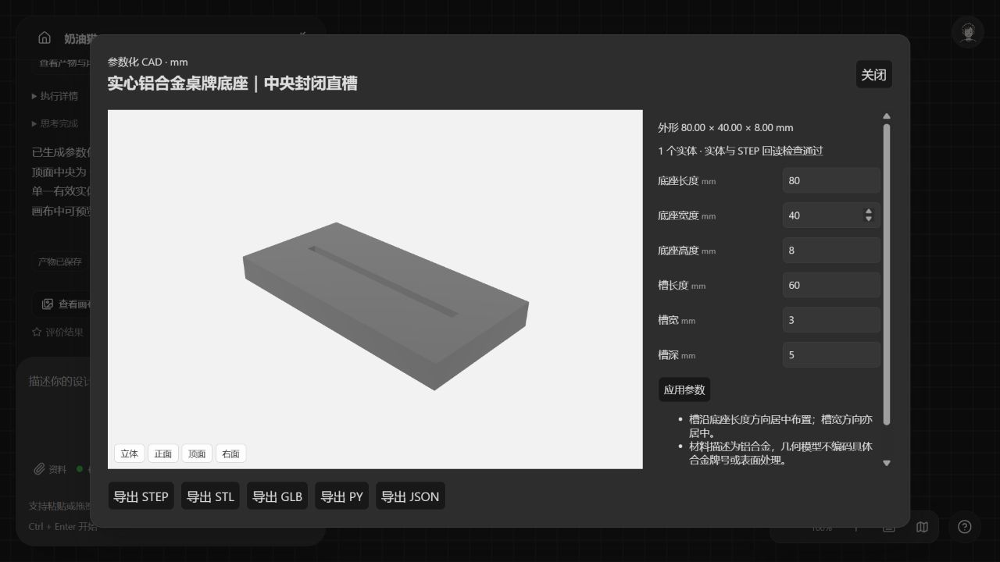

# MxinspireX 图文使用指南

适用版本：0.2.0，2026-10-22。截图来自真实浏览器任务，不是界面概念图。以下示例展示功能，源码包不附带测试工作区和个人生成记录。

[返回 README](../README.md) · [发布验证](RELEASE_VALIDATION.md) · [迁移与启动](../RUN_IN_CODEX.md)

## 1. 启动与配置模型

安装 Node.js 22 / 24 和 uv，完整解压源码包，在根目录执行 `npm run start:portable`。首次启动会安装锁定依赖。打开终端给出的网址，通常为 `http://127.0.0.1:5173`。

点击左下角头像，在概览卡片中选择 **设置**，进入 **模型与连接**。选择服务商、填写自己的 Key 并同步模型目录，再选择文本和图像模型。EvoLink 的 `https://api.evolink.ai` 已内置，只需填 Key。语音、视频应选择目录中真实可用的模型；3D 使用单独配置的服务。

设置页可以调整深浅色、吉祥物和个人资料。Key 不写入项目或导出文件。首次模型调用可能产生服务商费用；首页顶部和“用量与计费”展示真实记录。

## 2. 从需求开始创作

在首页输入主体、用途、数量、尺寸和必须保留的内容。通过“资料”上传图片、PDF、Office 文档或表格。输入框附带的图片是参考候选；清楚说明是借鉴风格、沿用主体还是编辑原图。

提交后进入项目：左侧持续对话，右侧显示画布。收起对话后，可用左下角 Agent 头像展开；左上角返回首页。画布右下角可缩放、适应视野和打开观察视图。

## 3. 同款产品主图与场景

示例需求：

> 为暖屿做两张 1:1 图片。第一张是陶土香薰炉产品摄影：奶油色滴釉、正面拱形烛台开口，米色背景。第二张沿用第一张产品，放在窗边木桌，保留造型、材质和颜色，只改变环境与光线。只做这两张，不做额外研究。

Agent 先保存主图，再把主图原始资产传入场景生成。场景不与主图同时盲目生成；多个场景的共同来源就绪后可并行。可点击“查看产物与用量”核对请求与保存结果。

图中上方为主图，右侧为窗边场景，下方为下一步的绿色背景编辑。三张图均保留在画布中。

## 4. 局部修改图片

单击需要修改的图像，将引用保留在对话输入框中，然后写明修改范围：

> 只把背景改成浅鼠尾草绿，保持香薰炉的形状、滴釉、颜色、构图和光照不变，输出一张新图。

局部编辑沿用原图。不要只写“重新做一下”而遗漏保留项。已有作品不被直接覆盖，可在画布查看原图和新版本，双击图片打开大图。

## 5. 上传资料生成批量海报

上传活动说明文件后，明确两张海报的不同方向及共同文案。例如：“按文档中的名称、日期和地点，做一张暖色排版海报和一张抽象图形海报，各一张 1:1。”

Agent 读取文档后，为独立海报提交批量任务；每项分别保存，单项失败不丢弃其他成功项。

## 6. 用已有图片制作交互详情页

上传商品图片，并说明“使用已有图片，不生成新图，制作 HTML 详情页”。可以描述章节、按钮和交互，如产品介绍、使用步骤、FAQ。

HTML 节点可预览，支持页内定位和展开内容。查看源码时可直接修改布局与文案。保存前检查 CSS 括号结构，避免错误覆盖原节点；这是本地语法校验，不是模型质量审查。导出入口按环境提供 HTML、PDF 等选项。

## 7. CAD、语音与视频

CAD 请求应给出明确尺寸，例如：“80×40×8 mm 底座，居中 60×3×5 mm 盲槽”。查看参数与几何检查后，通过导出入口保存 STEP、STL 或 GLB。

语音任务写明准确口播文字，视频写明时长、比例、镜头和运动。视频可能异步完成，等待期间不要反复提交；刷新或重新打开项目会读取原任务。3D 服务缺少配置时，应用在调用模型前停止并给出配置说明。

## 8. 状态、用量与失败处理

- **绿 / 黄 / 红** 分别表示就绪或完成、处理中或待配置、故障。
- 点击 **查看产物与用量**，核对原请求、产物、计费状态、耗时及调用。
- **已确认扣费**来自服务商回执；**参考估算**不是扣款；未返回实际费用的记录保留为**待对账**。
- 断流或结果未知时先查询原任务，不要为确认结果反复提交，以免重复收费。
- 部分完成时保留成功产物，只处理缺失项。设计效果由人判断，没有自动质量审查或自动重画。

## 9. 数据与备份

便携启动使用 `.local/portable-workspace/`；个人数据不在公开仓库中。停止应用后备份整个工作区，保持数据库、项目文件和资产一起移动。迁移机器时重新配置 Key，不复制系统凭据。

遇到问题时记录操作、任务 ID、模型和错误提示。不要在公开 Issue 中贴 Key、完整私密提示词或敏感附件。联系：[ziguishian@foxmail.com](mailto:ziguishian@foxmail.com)。
