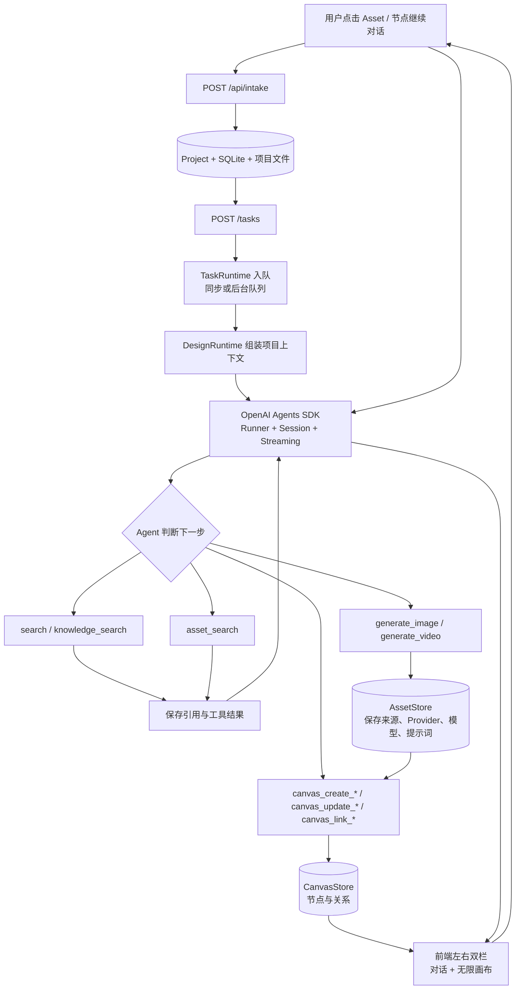

# Agent 运行逻辑图

交互网页生成新增按需媒体编排与固定离线组件框架。主 Agent 使用 `supporting` 标识网页内部素材，HTML 项等待真实媒体就绪后嵌入；不改变节点原样生成规则。筛选、切换、表单和播放器必须实现真实页面行为，表单无后端时明确为本地演示。实现、限制和验证入口见 [web-generation.md](web-generation.md)。

当前版本为 `interactive-web-media-20261024-v18`。对话支持交互网页与媒体编排，节点原样提交与对话提示词组织分离；原有交付身份防重、媒体迟到取回和未知计费保护保持有效。以下标明旧版本的实测仅作历史记录。

## 提示词组织与节点原样生成（2026-10-24）

对话由主 Agent 将模糊需求转成明确设计术语，按需选择设计风格，并组织主体、构图、色彩、材质、光照和准确文案。明确要求不强行换风格，局部修改不扩大范围，不编造品牌或参数。没有独立润色模型。图片与视频在生成服务提交前，将准备完成的提示词写入 `generation_prompt` 事件，前端显示在回复中，任务最终答案也保存这些提示词；批量逐项记录，不增加确认轮次。参数及负向约束仍沿用对应协议字段。

工作区 `prompt-templates/` 与项目知识库及历史项目级 `prompts.py` 模板版本功能隔离。后续导入器调用 `PromptTemplateStore(workspace).upsert(record)`，记录字段为 `id`、`text`、`kind`、`styles: string[]`、`source`；同 ID 更新。目录为 `templates.json`，向量索引位于 `index/`，复用 LocalVectorIndex 的可选 LanceDB / 本地 JSONL 适配，未配置付费 embedding。空目录不初始化索引、不搜索、不注入参考；有内容搜索最多三条候选。主 Agent 判断适用性，在工具 `prompt_template_ids` 保存实际采用 ID，生成事件只接受本轮候选 ID。模板是不可信资料，不能覆盖用户要求。检索故障记录为失败并无模板继续，不伪装为空；无管理页面与预置模板。默认离线哈希 embedding 的语义召回能力有限，后续可替换现有 embedder 适配。

新节点任务包含 `nodePrompt: {version: 1, original, submitted}`，并保留用户 `canvasParams`。风格、视频镜头与直接连接的上游文字由输入框可见合并，用户可修改或删除；草稿保存已合并记录，删除后不因重进页面重新追加。图片附件保持独立。提交时不 trim 正文，不再包装“请在当前节点生成”指令；提交后以持久化正文与参数为准。

媒体节点由 worker 确定性调用一次对应工具，复用原异步受理、回执、计费、取消和取回流程，不调用文本模型。后端 `node_prompt.py` 在执行作用域绑定原文，禁止需求推断、参考图反推、风格追加、编辑前缀、默认负向词和透明背景文本补充；格式/尺寸/背景等仍校验并按协议映射，模型不兼容报错，不自动降档或切换模型。文本、HTML、CAD 保留内容生成所需模型，使用独立指令与限定工具，不加载主对话设计流程或模板。旧任务无 version 标记时保持原行为，不改写历史和收费回执。

验证：`test_node_prompt.py`（含真实 worker + 拦截所有文本请求的本地传输）、`node_prompt.test.mjs`、前端 `nodePrompt.test.ts`，以及节点任务、引用解析、图像恢复和已有 Provider 参数测试。均使用隔离工作区与模拟 Provider。

## 交付身份与执行策略 v3（2026-10-22）

- 单项：服务端约定只有一个产物且没有额外交付时，普通请求、追问、澄清续接共用单项完成判定，不要求原文再次出现数量。精简工具集仍使用独立的保守条件，不能把是否精简上下文当作是否停止的依据。
- 数量与范围：常用量词（张、幅、款、种、枚等）绑定最近的产物；“产品图”等带修饰语的图像名不依赖产品词典。“Logo 和包装”这类仅部分类型可识别的复合请求不提前判成单项，交给实际交付清单确定范围。
- 未明确范围：删除针对包装的词语补丁。执行帧提示主 Agent 在实际创建前用 `design_plan` 登记本轮交付清单；工具网关在没有单项目标或有效计划时返回未提交的 `planning_required`。单项登记一项，多项保留数量与依赖，不增加独立规划模型或质量审查。普通回答不强制计划。
- 防重：`tool_delivery_claims` 将回执关联到任务内的单项槽或计划 scope/item，并记录已确认接收的补充版本。提示词、质量、交付 ID 改写不能绕过同一交付；同轮重复提交在 Provider 前拦截，成功结果跨重启复用。不同计划项、新任务不合并。
- 单项身份不因 Agent 自行补建计划或改名而重置；文字生成工具别名、遮罩重绘与图像生成共用对应交付身份。本地裁切和缩放不按收费生成处理。
- 补充：只有已接收的用户补充开启新版本；该版本再次生成后仍受防重约束，不再因历史上存在补充就永久放行。未知收费和运行中请求跨版本仍禁止重发。
- 完成：同一节点的重复回执只算一个产物，明确 `submitted=false` 的预检失败不算已提交产物；未知结果保留。计划完成采用真实回执绑定，其他 scope 的产物不冒充本批完成。多项独立交付继续并行，有上游身份依赖的项目按原机制等待真实图片。
- 版本：仅新任务写入策略 3；旧任务及其回执不迁移，不修改历史收费和产物。测试使用本地 Provider/SDK 夹具；重点矩阵在 `test_delivery_identity.py`、`test_execution_efficiency.py`、`execution_efficiency.test.mjs` 和 `generation_batch.test.mjs`。

## 跨类型实测修复 v15（2026-10-22）

- 用户“不做研究”跳过自动参考发现；明确仍要找参考时优先保留该要求。已上传参考和同款母图依赖不受影响。
- 交付语义识别“不调用/不使用/不做/不加”等否定表达。HTML 中已有商品图的说明和复用关系不再误算为新图片；明确另生成海报仍计入混合交付。
- 记忆未选用时，写入工具与服务端采用相同的前置条件。上下文明确告知先选用再开放制作工具，避免无效参数回合或误报没有能力。
- 图片/附件作为 HTML 输入且没有 HTML 修改目标时，补齐 `output_mode=create`；已有网页仍要求明确编辑目标，不猜测覆盖。
- HTML 保存前本地校验 CSS 括号结构，忽略字符串、注释及转义；语法不完整时不覆盖原节点，按现有参数纠错处理，不调用审查模型。该检查不评价视觉质量，也不承诺捕获所有 CSS 语义错误。
- 请求检查面板从异步 job 和最终交付记录获取真实节点，仍按当前项目过滤；异步完成时清除旧等待状态和重复完成文案。旧记录仅在读取时规范化展示，不修改历史费用。

真实浏览器矩阵、首次失败和修复复验见 [browser-design-sweep-20261022.md](browser-design-sweep-20261022.md)。

## 同款产品身份依赖 v13（2026-10-21）

原问题：主图和生活场景虽然都写“同款香薰炉”，却被作为无参考的独立文生图并行提交；第二张没有第一张的实际像素，产品造型因此可能不同。

现在的链路：

1. 一次 `design_plan` 合并交付范围与输入关系。后续场景的 `inputs` 使用 `source=deliverable, role=identity`，指向产品主图；有现成用户产品图则直接引用 `source=asset`，不额外生成母版。明确的同款多图任务也登记这份短计划。共享风格、品牌或清单顺序本身不产生依赖，Logo 不作为产品造型的替代来源。
2. 先生成主图，文字卡等独立项仍可并行。即使模型把主图和未来场景放进同一批，worker 也只提交已就绪部分，把依赖真实主图的场景留到下一轮。成功回执附带本地读取的实际主图预览与资产 ID，主 Agent 可直接看图并组织下一项参数，不额外跑看图/改写模型。预览仍遵守单图 2 MB、总计 8 MB、最多 8 张的预算。
3. 场景请求按计划自动解析真实资产文件，必须提供基于主图的 `reference_analysis`，保留轮廓、比例、开孔、部件、材质、颜色和标识；只按用户要求改变场景、光照、视角或指定部分。误写为仅语义参考的 `inspiration` 会在预检规范为传入原图的 `identity`，明确换背景等仍保留 `edit` 语义。没有主图或分析时不提交付费生成，不能静默退化成文生图。
4. 多张场景共享同一主图，就绪后可以并行；不逐张串成漂移链。成功交付项继续按稳定 ID 复用，未知请求不重发。没有质量审查、自动重做或额外收尾模型。旧任务和旧图片保持原样，已接受计划不被静默改写。

回归入口：`test_product_identity.py`、`generation_batch.test.mjs`、`test_execution_efficiency.py` 的 `product_identity` 场景。Responses 和 Chat Completions 的本地 SDK 集成覆盖“计划 → 主图及文字 → 同款场景”共 3 次文本请求、2 次图像提交，断言下一轮确实收到主图像素、场景 Provider 收到同一资产、重复提交不再生成。测试使用本地模拟 Provider，不冒充真实模型的视觉质量测量。

## 浏览器回归修复 v12（2026-10-21）

混合交付通过一次 `design_plan` 固定类型、数量和稳定 ID，`coverage` 可为空，不增加研究、澄清或质量审查。文字卡对应 `text`，使用 `canvas_create_text`；图像项使用图像工具。同一交付项已有成功回执时即使模型自行改写提示词也不重做。未完成的独立项仍使用批次并行，全部真实保存后直接完成任务。数量解析不跨过下一个产物名词，“两张图和文字卡”不会错误推导成两张文字卡。

图片/音频通过各自持久化操作队列异步执行，EvoLink 受理 ID 单独保存。查询和公开下载允许有限 GET 重试；结果未知时不再 POST 生成。任务详情支持取回原结果，随后按真实资产和播放检查更新任务及界面。恢复不覆盖用户已有内容，不复活已取消任务，计费更新原账本。EvoLink Responses 历史在请求边界转为可移植内容，保留本地原记录与工具调用配对，避免旧服务端资源 ID 引起跨资源 400。接口边界见 [EvoLink 接入](evolink-integration.md)。

最终浏览器回归：两张 1:1 图片加一张文字卡，2 次 SDK 请求、2 次图像提交，界面用时 1 分 3 秒；生成后直接结束。详细费用、失败测试和配置限制见 [修复复验报告](browser-repairs-20261021.md)。

## 单图链路与观测 v11（2026-10-21）

1. 首轮明确单图：无参考时本地初始化空记忆；恰有一张关联项目的真实、已解析图片，且没有历史、其他事实、计划、Skill 或未解决引用时，本地将目录原记录选为候选。不是用户已确认的 Logo/母版，也不推断图片用途；Agent 仍看原图预览、判断用途并提交逐图分析。已有选择和恢复检查点保持原样。
2. 单图模型输入去除重复请求、目录中重复的已选项及不相关画布/输出摘要；原始请求、近期对话、选中记忆、图片、尺寸/风格、引用范围和错误仍保留。唯一候选和空目录隐藏不必要的记忆写入 schema；读取记忆后可恢复写工具。复杂资料、用户补充和 Skill 保持完整入口。
3. 识别单图时允许“并保留外观、然后把标题放上方”等视觉修饰；附带分析、另一件作品或导出仍走完整流程。批量参数和逐图参考分析一次列出各条目错误及字段路径；批量预检全部通过才保存预检版本，不为错误重新写计划。
4. `completionDecision` 统一工具成功后与交付检查后的判断：只有真实产物、已终止尝试或待核对状态；缺项补全仅处理依赖就绪的未完成项。等待用户、异步结果、未知收费和运行中补充不能触发盲目补生成。`attempt_complete` 只表示本次尝试结束，不等于交付通过。无质量审查或收尾模型。
5. `task_timing.py`、SDK 性能和 EvoLink 传输记录上下文准备、文本模型、图像预检、参考上传、提交、服务商等待、下载及资产保存，任务详情可查看。排队/处理是轮询观测区间，已包含在服务商等待内；并行累计耗时不可直接相加。缺失值为 null，不冒充 0。
6. EvoLink 成功参考上传按文件路径、内容哈希与凭据哈希在进程内复用，最多 128 项，只信任官方返回的带时区 `expires_at`，预留完整生成等待窗口；不持久化 URL 或凭据。过期/变更不复用，未知生成请求不重发。详见 [EvoLink 接入](evolink-integration.md)。

目标：简单首轮 1 次文本 + 1 次图像，多参考通常 2–3 次文本；实际轮数由模型和输入决定，不降低图片规格、不增设硬性成本轮数限制。回归覆盖两种 SDK 协议、单参考/局部编辑/多参考、参数聚合、未知结果、运行中补充、上传有效期与观测缺失值。

本机真实验证（2026-10-21，GPT-6 Luna + EvoLink Flare，创意档 1K）：

| 场景 | 文本调用 | 图像提交 | 文本 Token | 总耗时 |
| --- | ---: | ---: | ---: | ---: |
| 原产品图 + “生成一张海报图” | 1 | 1 | 4,855 | 54.1 秒 |
| 无参考咖啡海报 | 1 | 1 | 3,625 | 41.3 秒 |
| 原产品仅替换背景 | 1 | 1 | 4,882 | 50.5 秒 |
| 产品图 + 风格图生成单图 | 2 | 1 | 13,572 | 67.5 秒 |

同一海报原文的 v10 样本为 2 次文本、10,702 Token、72.2 秒；本次减少 1 次文本、54.6% 文本 Token，耗时减少 25.1%。均为单次样本；上游延迟不固定、未指定比例由模型选择，不当作固定规格基准或扣费降幅。另有一次初测发现 `ExecutionStore.load()` 会给新任务返回 `toolOutputs:[]`，错误跳过本地候选选择；已修复为空值检查并补真实 Python→Node 入口测试。初测成功保存一图，2 次文本、9,937 Token，单独保留，未重复提交原请求。本轮总计 5 次成功图像请求、36,871 文本 Token；费用缺失继续待对账。

## 图像提示词边界（v9）

主 Agent 将已接受的设计规格、实际采用的参考特征和准确图内文案提炼为一段视觉描述。只写主体、构图、色彩、材质、光照、风格及必要保留项；简单图片通常 80–220 个汉字，复杂排版按实际内容展开，不硬截断文案。编辑提示以“图像编辑任务：”开头，说明修改及不变项。尺寸与格式放结构化参数，制作说明放 `production_notes`。

后端不再追加整段 `visualDirection` / `imageSpec`、参考观察与 `synthesis`、选图资产 ID、前置文本/HTML 全文和生产流程说明。上述内容仍保留在任务与资产快照中，校验和依赖绑定不变。传给图像模型的补充只包括实际输入图序号与保留范围、套系锁定的可见布局、透明背景和短视觉排除项；重复约束不重复追加。不新增提示词压缩、重写或审查模型调用。

回归覆盖 `test_image_prompt_scope.py`、`test_image_reference_design.py`、`test_image_request_resolution.py`、`test_visual_series.py` 及 SDK 参考分析用例。旧的已生成资产保留原提示词，新生成使用新规则。

## 执行优化策略 v2（2026-10-21）

多图真实测试补充：主 Agent 的旧默认 4096 输出额度也按服务端 `deliveryContract` 的交付总数判断；两项及以上在首次规划前预留 32768，上限受模型已声明能力约束。已有两/三项计划同样适用。自定义额度、单产物、普通对话保持原约定；截断后仍不自动重发已提交请求。

### 简易设计的三处收敛（运行版本 v4）

独立 Logo 在没有明确布局约束时，提示图形与字标整体居中、宽高各不超过画布对应边 60%、四边至少 20% 留白；用户要求和已接受布局优先，不将此建议用于包装、样机或局部修改。

参考选择同时识别“无需联网或参考选图”等并列否定表达，直接跳过选图预检，避免启动无用的参考搜索；“无需联网，但先选择本地参考”仍保留选图要求。

图像 Provider 的 401/402/403（鉴权、余额或权限拒绝）保存为当前任务的终止回执；改写提示词、批量工具和 worker 恢复均不能重新提交。`generationAttemptComplete` 将 `stopTool` 失败计为已尝试且停止，避免自动补齐阶段再调用模型要求重做。保留已保存文本，交付仍显示缺项，不冒充全套通过；解决账户问题后由用户发起新任务。

- `reference_efficiency.py` 仅为没有显式参考或调研要求、附件、系列或复杂依赖的单图/网页，及已就绪的一图加一份文字计划处理空参考。自动预检只查一次本地库，不为原创概念额外启动付费联网搜索；无可用图片时服务端保存 `unavailable`，生成继续，不创建空选择卡、不再换关键词搜索。显式要求找参考、最新趋势、已有候选图和复杂任务仍保留确认流程；同任务相同搜索参数复用回执，缓存不进入模型上下文。
- 就绪计划已随每轮执行上下文提供，运行器动态收起 `design_plan` / `design_state`，保留实际制作工具；新批次、运行中用户补充、执行失败和明确的 Skill 工具要求重新开放。参数格式错误仍在原计划下修正，不因错误重写视觉方向、交付物或验收条件。
- 计划版本由运行器绑定到本次模型请求实际看到的 `designPlan`，不接受模型猜测的 `expected_revision` / `expected_scope_id`，也不与 `design_state.revision` 混用。首次计划使用版本 0；真实并发冲突仍由服务端拒绝并返回有效计划，同类冲突受重复错误预算约束。
- 就绪后的进度由实际工具事件报告，参考预检由生成入口自动执行；模型侧同时收起 `report_progress` 和 `generation_reference_check`，避免专门报告进度或重复预检再消耗一轮模型调用。业务工具内部的参考、记忆与参数核验继续执行。
- 品牌应用清单通过 `canvas_create_text.application_items` 一次提交建议项与选配项，`application_inventory.py` 按实际保存节点生成“本轮已交付 / 建议后续制作 / 按需选配”。只对带结构化清单元数据的本任务节点生效；已生成不等于质量通过，不伪造交付，不覆盖手动改文。最终核验重新计算指纹，无变化不写入，不调用质量审查模型或自动付费修复。

回归入口：`test_design_efficiency_gaps.py`、`test_execution_efficiency.py`（真实 SDK，模拟 Provider）、`execution_efficiency.test.mjs`。

真实验收补充：模型同时提交结构化清单和完整 Markdown 清单时，本地只移除重复的分类标题和对应条目，保留范围与制作说明、原始文本和真实产物依据；不会把清单渲染两遍。`task_policy.py` 同时识别“没有制作 Logo，不需要生成图片”这类明确不制图的表述，纯文本任务不再产生虚假缺图；实际正向制图请求仍保留，回归见 `test_delivery_exclusions.py`。

清单自身保存后也计入已交付，不能因它是清单而从完成证据中排除。产物、文件、参考和用户补充的变化使本地交付检查缓存失效，不调用模型审查。

新建任务由服务端保存 `executionPolicyVersion=2`，恢复旧任务沿用旧策略。普通设计中的定向查证由主 Agent 使用已有搜索、知识和资料工具完成；只有明确要求独立研究报告或单独研究阶段，才启用研究 Agent。否定句、引用和历史叙述不触发独立研究。最新事实仍需真实来源，未联网或查证失败时明确标记未核验。

服务端仅为范围明确、数量为一、没有额外分析/导出或 Skill 步骤的图片、文本和 HTML 任务保存 `singleDeliveryTarget`。生成工具取得真实节点和内容后，执行器核对运行中补充，直接转入本地交付检查，不再要求主 Agent 专门生成收尾回复。HTML/媒体仍等待必要的预览；未知收费、占位节点、失败、混合交付、缺项和新补充都不视为完成。最终回复来自实际回执和检查结果。普通文案由主 Agent 写完整内容并调用 `canvas_create_text`；`generate_text` 保留供历史任务和明确需要该工具的 Skill 使用。

研究阶段使用专用精简说明；确定输出类型后省略不相关的网页、CAD 等规则。用户原文、更正、否定约束、参考用途、visualDirection、imageSpec、依赖及验收条件仍由原有上下文和计划机制保留。成功写入工具只向模型返回节点/资产 ID、版本、简要内容及读取入口，不重复发送整张画布或完整 HTML；真实回执、Session 中已保存的历史和资产内容保持完整，验证失败中的精确 ID 不截断。

本地交付检查在同一服务进程复用最多 32 个任务的成功报告。每次读取仍校验输入、画布内容、资产文件状态、参考和事实来源、预览结果、异步视频及补充版本；任一变化即失效。待生成、待预览和失败报告不缓存；重启后重新检查。结束时根据最新真实文件与节点状态更新交付结果，不启动模型审查或自动重生成。

`GET /api/projects/{project_id}/tasks/{task_id}/inspection` 的 `performance` 包含 SDK 请求次数（包括失败/未确认请求）、已完成响应、额外搜索/文本请求、按提交标识去重的图片请求、SDK 输入/输出 Token、阶段及首个产物耗时。实际 SDK 响应以 `sdk_response` 写入现有模型调用表，响应 ID 去重；外层 `main_agent` 路由不是一次真实模型调用。未记录数据为 `null`，旧任务覆盖范围为 `legacy_unknown`，从旧检查点开始计数为 `partial`。这些指标不是服务商账单，SDK Token 不包括媒体和独立搜索用量。

离线回归入口：`test_execution_efficiency.py`、`execution_efficiency.test.mjs`、`test_gift_plan_recovery.py`。当前单图/文本/HTML 可 1 次主 Agent 完成，图片另有 1 次生成提交，不含审查。运行中补充需要主 Agent 继续判断，不强行截断轮次。Windows 使用 `python -X utf8 -m pytest`；夹具通过 file URI 载入 Node 模块，并使用 UTF-8 交换 JSON。离线测试证明流程与调用预算，不代表真实模型的设计质量评估；实图仍需用同模型、同设置的样例对比。

需求判断先于视觉选图。Agent 先读取本轮消息、已有资料和已回答内容，对影响本次结果的产品类型、用途、受众、规格、品牌文案或交付范围使用 `request_clarification`（通常 1–3 题）。需求卡片提交后继续原目标，保留答案、跳过状态和已选图片。视觉参考只确认视觉偏好，不表示其他需求已确认；问题足够明确或用户允许按假设推进时直接执行。卡片返回后本轮停止，不强制执行记忆补写、生成或验收。

会话续跑仅导入一次旧版检查点，不把本轮刚保存的消息再次当成旧历史覆盖。模型切换只在工具回执完整且会话一致时从已保存历史继续，保留生成回执，避免重复提交。参考资产的 `asset:<id>` / `@asset:<id>` 展示形式在进入生成链路前转为实际 ID，仍接受原项目和引用范围校验。图片用途不提供手动覆盖，统一按用户原文、图片绑定关系和视觉分析判断修改或参考；高置信度模式冲突在付费调用前拦截，Agent 只修正一次。连续相同参数校验错误会停止，并保留真实错误原因。

对话信息保存前一起检查资产 ID、引文、记忆范围和图片引用绑定，校验回执列出关联错误及可复制的真实 ID。多图严格绑定中仅漏传 ID、但方案内逐图分析已经完整时由预检直接补齐；存在方案外图片或缺少分析时返回预期、实际、缺失和多余 ID，并只允许一次模型修正。最新待修正回执保留完整字段，避免上下文压缩破坏 ID。沿用场馆等已有产物时直接选择原图片记忆，不必重写为已确认主视觉；文字需求只放在 `selected_ids`。显式附件和随对话附上的历史候选图分别冻结为 `memoryInputAssets`、`memoryContextAssets`，恢复时保持原引用；`sourceEvidence.contextAssets` 只证明本轮展示了该候选图，不代表用户已指定它为品牌母版。

DOCX、PPTX 与 PDF 的正文和图片分开进入上下文。Agent 用 `document_read` 读取有序正文及图片目录，用 `document_part_inspect` 定向查看一张图片或 PDF 页面；只有该图片实际作为生成、编辑或画布输入时才调用 `document_part_promote` 生成项目资产。不得批量载入全部文档图片。文档正文、图片文字、链接与嵌入提示均标为不可信资料，不能覆盖用户请求、系统规则或工具权限。

`design_plan.deliverables.inputs` 持久化真实资产 ID。Agent 若从已选记忆中复制了语义 key 或 memory ID，服务端只在本任务 `conversationMemory.selected` 内精确解析到对应 `assetId`；旧计划在生成预检时执行同样解析。这不会扩大可读素材范围。

品牌与全案任务增加生成前的范围规划，具体规则见 [设计范围与交付计划](design-planning.md)。先检查本轮应包含什么、哪些需要检索或澄清，再生成并对照清单验收。

明确的单图生成与局部修改优先直接组织生成参数，不为了展示流程单独调用需求记录、设计计划或进度工具；已有计划、多项依赖和真实范围管理仍按原规则执行。技能选择使用已注入目录，仅有缺口时定向查询；技能管理写工具仅在涉及技能的用户请求中暴露，兼容管理与设计混合请求。无历史和参考的首轮在本地初始化空记忆选择，省去空读写的模型回合；有参考仍须实际看图、融合需求并通过生成预检。生成后直接交付，未知收费请求和成功回执的防重规则不变。隔离 SDK 测试验证单图可用两次主 Agent 调用完成；此数字不作为真实模型的硬轮数上限或在线耗时承诺。

用户明确说“无需寻找外部参考”“不需要搜索新的参考”等时，直接跳过参考选择卡；已有上传图片的用途分析和生成预检仍保留。“不要跳过参考”不按跳过处理。

参数恢复覆盖两层：进入网关前的 Zod 校验与 SDK 提前拒绝的非法 JSON 都生成 `invalid_arguments` 回执，计数写入检查点。同类错误最多两次修正，每阶段累计最多六次；恢复不会清零。仅 `design_plan` 的空对象/null 读取，以及明确放错一层的 `research` 可本地规范化，不猜测设计内容或生成参数。

就绪计划直接执行。无变更原因的重复保存只读取已经通过校验的原计划，返回 `plan_reused`，保持原 ID、视觉要求、验收和进度；不采用或校验重复提交的替代正文，也不计入参数恢复预算。本批已提交生成全部结束后，计划复用直接进入本地保存核对。有新证据、用户补充或真实制作/依赖问题时可提供 `change_reason` 修改，仍不得降低已接受的验收。经过服务端验证的选图/跳过参考，以及纯“继续原设计任务”，复用原计划与批次；新需求答案、范围修改或下一批仍按原规则重新判断。工具返回的状态和下一步指令优先于大段计划内容保留。

`test_gift_plan_recovery.py` 使用本次杭州七项礼盒需求和真实 SDK、隔离 Provider，覆盖澄清—计划—跳过参考的续接、参数纠错与恢复、重复计划停止、七项生成与直接交付，以及成功回执不再次调用 Provider。真实模型速度仍需另行测量。`/health.agentRuntimeRevision` 标识实际运行的这组修复，避免仅凭源码或外层旧启动标签判断版本。

七项实测还暴露了旧版 4096 tokens 单轮默认额度会截断长计划。`model_output.mjs` 在提交前将需要规划或至少两项交付的默认额度预留为 32768（受模型声明上限约束）；普通任务、非默认自定义上限保持不变，不改写已保存配置，也不要求模型用满额度。`design_plan` 已能继承同任务派生说明中的视觉方向，工具说明不再要求重复序列化。Responses 的 `response.incomplete/failed` 和 Chat 的长度截断在工具执行前停止，保留已报告用量并标记已提交、计费待核对，不当作未提交或能力不足，不自动重发和换模型。界面区分输出上限与其他不完整文本响应；旧版错误同样可识别。长计划和截断工具的真实 SDK 回归覆盖两种 API。

杭州礼盒需求中的“历史经典标签”属于设计元素，不进入文本标签批处理。普通礼盒全案不因“完整方案”四字自动开启研究阶段；需要最新事实、竞品或研究资料时才启用。续接会携带用户决策和已接受的计划，执行工具逐项关联真实产物；缺项交回主 Agent 补齐，用户查看作品并自行决定修改范围。

会话、恢复、阶段交接和验收规则已升级为官方 SDK Session/RunState 加本地持久化适配，详见 [会话与上下文](conversation-context.md)。研究、设计按任务需要分阶段运行；未完成交付或运行异常使用兼容状态 `deliveryStatus=needs_review`，不把设计质量判断作为完成条件。

任务创建接受可选 `requestId`。浏览器在收到创建响应前持久化该 ID，队列消息直接复用自身 ID；服务端以 `projectId + requestId` 保存请求正文哈希与任务 ID。相同 ID 和相同内容返回原任务，相同 ID 改写内容返回 `409`，因此创建响应丢失后重试不会产生第二个任务或第二轮 Provider 调用。旧客户端不传 `requestId` 时继续按原方式创建任务。

当前生产链路是一个以工具调用为中心的设计 Agent。`TaskRuntime` 只负责任务持久化、恢复、取消和事件轨迹；`DesignRuntime` 把一次任务交给 Node 侧的 OpenAI Agents SDK；业务能力由 Python `DesignToolRegistry` 提供，Agent 不直接访问供应商 API，也不操作前端 DOM。项目 Brief、用户上传资料、显式导入的研究来源和真实 Provider 返回值是业务内容的来源；缺失时流程停止或保留空状态。

Agent 的行为由工具结果驱动，而不是由固定的 23 个步骤驱动。面对不同领域的设计需求，它可以先检索企业知识，再搜索已有资产，随后生成图片/视频，最后把结果放进画布；也可以只创建一份方案文本，等待用户继续约束。每次调用都保留工具名、参数摘要、耗时、Provider、模型和返回资产 ID。

所有生成任务先判断实际依赖。Agent 使用 `generate_batch` 一次提交当前输入已就绪的独立产物，每项指定实际生成工具、完整参数和对应 `deliverable_ids`。批次协议接受条目外层或 `arguments` 内的 `deliverable_ids`，进入校验前统一为生成工具参数；两处同时填写但内容不同会被拒绝。图像、视频、音频、3D、文本与网页共用同一执行规则，没有固定并发数量；SVG 生成全局禁用。旧设置中的并发上限会被忽略。计划里有多个可执行项而 Agent 仍尝试逐项调用时，执行器先返回 `batch_required`，让 Agent 准备整组参数后再调用，期间不提交收费请求。

`design_plan.openQuestions` 只保存会阻止当前批次执行的问题；概念稿可以留白或用明确假设继续时，正式定稿待补信息写入 `deferred` 或验收条件。计划返回 `needs_clarification` 后直接形成用户提问卡片并结束本轮，不能重复改写同一计划或继续生成。

图像批量预检查同时准备实际 Provider 参数，整批合法后再派发。套系版式尺寸与服务生成尺寸分开，保留原比例，按 OpenRouter、原生 Images API 或多模态协议转换，详见 [图像尺寸与 Provider 适配](image-provider-dimensions.md)。

共享已确认风格或已有参考素材不构成先后依赖。需要引用上游新产物的交付项用计划中的 `dependsOn` 标注，等上游可用后再提交真实资产 ID；同一节点和同一交付项的修改顺序执行。每项资产、节点和工具回执独立保存，一项失败不丢弃其他成功结果。仅当请求仍在本进程实际执行时允许独立生成并发；响应丢失或重启后保留未知结果保护，避免重复收费。用户设置的积分预算仍按每项实际调用预留和结算。

点击画布中的媒体节点会把 `@asset:<id>` 写回左侧输入框。下一轮任务只提交资产 ID，sidecar 在项目边界内重新读取本地文件并交给 Agent；用户不需要复制 URL，也不会把绝对路径发送到浏览器或模型。

各层的数据边界如下：

| 层 | 输入 | 输出 | 真实数据门控 |
| --- | --- | --- | --- |
| Intake | 用户 Brief、上传文件、资产引用 | 项目记录、解析文档 | 没有 Brief 或文件时不创建任务 |
| Research / Knowledge | 项目文档、共享文档、显式 URL 快照 | 来源、片段、引用 | 不把默认文本当研究结论 |
| Agent | 项目上下文 + 用户消息 | `AgentResult`、工具事件、引用和下一步 | 无真实 Provider 或 SDK 依赖时返回可操作错误 |
| Tool | 结构化工具参数 | 检索结果、Asset、画布节点或关系 | 工具层校验项目边界、Provider 和来源 |
| Asset | Provider 返回的图片、视频、音频或文档 | 内容哈希资产、来源元数据、可引用 ID | 不把裸 URL 当作最终产物 |
| Canvas | Asset ID、文本和节点关系 | 项目级节点/边文档 | Agent 不能直接操作前端 DOM |
| UI | Agent 事件、任务状态和画布文档 | 对话历史、无限画布、继续编辑 | 画布可隐藏，隐藏时产物回到对话上下文 |

## 生成前的需求整理

主 Agent 理解原始消息、项目上下文和本轮引用后，在制定计划或澄清前按需整理任务说明。适用于整套设计、多项交付及零散复杂需求；普通问答、技能管理、明确局部修改不强制经过这一步。没有新增模型、独立执行阶段或用户确认门槛。

`design_brief.mjs` 提供行为说明及工具参数结构；主 Agent 通过已有 `design_state` 工具同时提交可选 `brief` 和 `decisions`。`design_brief.py` 校验说明长度与结构，随后与需求决定在同一事务中保存到任务的 `designState.brief`：

- `summary`：设计任务的整理表达，不替换 `userMessage` 或 `designState.goal`。
- `assumptions`：可自行决定的暂定创意细节，不作为用户确认事实。
- `openQuestions`：实际阻塞本轮执行的待确认事项；保存说明本身不暂停任务，必要时仍用 `request_clarification`。
- `visualDirection`（视觉任务可选）：受众、主题、核心创意、层级、造型、材料/工艺、色彩、构图/光影、避免项及来源类型。它不保存隐含推理；全案的每个图像交付项还必须以 `imageSpec` 写清主体结构、比例、材料制作、取景、光线和本图避免项。预检在本地编译这些内容与 `reference_analysis`；缺少具体制作决策或只有“高级感”等词时不会提交 Provider。
- `sourceTaskId` 与 `status=derived`：由服务端写入，明确说明的来源及派生性质。

硬性参数、精确文案与否定要求仍以用户原文为准；`decisions` 中 confirmed/unknown 的原文引用继续接受项目范围及来源校验。润色说明不改变模型、质量、尺寸、交付契约或权限。计划与生成同时遵守原始要求、最新更正、澄清答案和整理后的说明；这属于模型行为约束，不能把结构校验当作摘要语义完全正确的证明。

后续模型调用与恢复通过需求状态获取说明；SDK 上下文预算中将说明与已确认决定分开保留，完整内容可读 `design_state`。修改需求或补充澄清答案时丢弃旧说明；纯确认续接可以复用，已有说明后单独变更 decisions 也会使其失效。前端在任务进度中提供默认收起的“本轮设计需求 · 已整理”，分别展示假设与待确认项，需求决定不因存在记忆面板而隐藏。

## 生成后直接交付（2026-10-21）

生成并保存节点 → 本地确认文件、数量和必要预览已就绪 → 直接交付。设计质量由用户判断，不再调用自动审查模型，不自动修复或复审。

已删除 `canvas_review.py/.mjs`、`review_evidence.py`、审查解析/缓存、`delivery_snapshot` 工具及前端审查状态和建议修订入口。旧任务读取时忽略历史审查，不改写原始记录或计费账本。

异步 HTML、音视频等待已有预览/文件就绪后，由本地服务结束任务；迟到图片直接更新已保存产物。生成前参数校验、参考分析、文件有效性及未知收费请求保护继续保留。

单产物模拟测试在 Responses 和 Chat 两种协议下均为一次主模型调用、零审查调用；视频回填不再调用模型。历史实测中的审查耗时不再代表当前流程。

## 简单单图执行 v10（2026-10-21）

服务端已有 `singleDeliveryTarget` 明确为单图、没有已接受计划/复杂输入/必选参考/指定 Skill 时，已解析的图片附件也进入单图直达路径。需求理解、设计选择和最终画面描述合并到生成工具参数，不再开放 `design_state`、`design_plan`、`generate_batch` 等无关工具。当前用户原文、来源、最近对话、已选记忆和必要校验继续保留。

附件由原有 `bootstrap` 登记真实资产来源；主 Agent 实际看图后，使用已有 key 在一次 `conversation_memory_update` 中完成选择。新增观察才写 changes，新增项也可用 key 同次选择。记忆未分析时暂不开放生成，避免“先调用生成 → memory_required → 写入 → 再选择”的往返。参考仍按项选择并提供 reference_analysis，不自动把所有候选图设为用户确认母版。

单图使用精简指令和工具集合，记忆成功回执只保留版本、选择和快照；完整状态已在独立记忆块注入。原始附件与记忆中的不同尺寸预览按真实 assetId 去重，同一图片只发送一次，不改变存档及图像 Provider 使用的原图。执行中新增要求、加载 Skill 或复杂输入恢复完整流程。

正常有参考单图以“选资料 → 生成”两轮为目标，无参考空记忆可直接一轮。2–3 轮是常见目标，非失败恢复硬上限。成功本地交付，不增加质量审查、提示词改写或收尾模型。Responses/Chat 两种协议的隔离 SDK 回归验证两轮完成、一张图、没有 memory_required 或重复规划；真实耗时与 Token 以线上任务记录为准。

## Worker 协议与停滞恢复

Python 侧只把 stdout 当作 JSONL 协议通道，并记录最后一个有效帧的时间。90 秒无有效事件只提示一次；10 分钟无有效事件终止 worker、保存检查点并返回可由用户继续的 `execution_timeout`，不在模型路由中自动重放。连续三个非法帧会终止运行，诊断只保存原因、字节数和 SHA-256，不保存可能含凭据的原文。`result` 必须且只能出现一次；缺失 usage 或 checkpoint 会写入协议诊断，缺失 result 仍视为运行失败。

2026-10-14 七项礼盒实测的后续失败并非输出截断：八次响应输出最多 4041 tokens，失败来自范围字段中文标题、批次漏传工具名，以及重复计划的层级混放。范围 area 在工具 schema 中声明当前框架英文枚举，已知中文别名本地归一；未知范围仍精确退回。plan 的已提供字段可从外层归位，冲突不覆盖。已有 ready 计划且没有 change_reason 时，重复提交在新参数校验前只读取原计划；不采用替代内容，明确变更仍完整校验。批次只有在全部显式 ID 可对应 ready 计划的非矢量图片项时才能补 generate_image，不猜未知 ID 或混合类型。已就绪套系的 Agent 比例偏移在共享预检/执行路径按原计划规范化，用户明确尺寸/比例、画布尺寸及像素参数冲突仍严格校验。收费匹配仍使用原始参数。真实失败调用形状作为隔离 SDK 回归夹具，两种协议均验证七项生成、计划不被改写。

## 图像断流、迟到结果与计划收尾（2026-10-14）

Images / 多模态接口读到 `IncompleteRead`、连接重置或超时，按未取得最终响应处理：节点为“生成结果待确认”，原收费回执仍阻止重发。完整但非法的 JSON 响应是已发现的响应问题，不能混同为未收到响应。图像生成不因断流自动换模、降级或重试。

Node 与本地工具网关失联（包括默认约 5 分钟的响应头超时）后，`image_result_wait.mjs` 仅查询原始参数对应的持久化回执。API 校验项目与任务归属；活动请求最多等待 15 分钟，查询本身不请求 Provider。原 Python 请求保存的成功资产会进入当前批次、产物引用。非活动未知请求、取消和等待到期都不提交第二次生成。恢复检查点时，真实成功回执替换旧连接失败和批次失败摘要，同时保留已有成功回执的附加上下文。

`plan_reused` 是无变更的计划复用，不是参数错误。当本批全部交付已保存，或已返回不可重试的生成待核对结果，再次复用计划直接结束设计阶段，继续交付核对；尚未生成的项目、无效参数和待计划批次不能被这个条件提前结束。已有视觉要求、交付范围、参数纠错保护和技术轮数保护继续生效。

七项礼盒回归包含六张成功、一张断流、两张本地连接超时后迟到，验证只有七次模拟生成、六张全部保存到画布、计划原样保留且未知请求不能重发。画布自动排版避开任务锁，解锁补排；锁竞争返回 409 时刷新本地快照并延后排版，不把原始错误 JSON 展示为 Agent 生成失败。

## 2026-10-14：工具契约与持久化图像执行

2026-10-21 实测修正：明确“直接生成/制作”时跳过自动参考检索与选图确认；仍尊重用户要求先找参考或禁止跳过，引用文案不作为跳过指令。单产物的“放到画布、做一次质量审查”不增加交付范围，保留快速完成路径。等待参考选择或需求补充时不标记交付通过，前端也兼容旧任务的误标记。

对无参考输入、无 Skill、无既有计划的明确单产物，主 Agent 将设计判断直接写进生成参数，不提供可选的计划、派生说明和单独预检工具；生成网关内部校验和本地保存检查照常执行。运行中用户补充要求时恢复规划工具，不能用原先的单产物范围提前结束。

最终保存结果优先于批次生成中的旧状态。成功后直接展示已完成；审查状态和质量问题分类不再出现在界面。实际模型和端点由运行记录提供。

`tool_contracts.mjs` 从同一份本地 Zod 定义生成发送给模型的 JSON Schema。`generate_batch` 的每个分支包含对应生成工具的参数结构，不再只描述一个任意参数对象；常用图像参数显式声明，创意描述仍是完整文本。已确认的官方入口、明确声明能力的目录条目才启用 `strict`：所有对象关闭额外字段，可选值在传输时用 nullable 表达，执行前仅去掉可选且业务上不接受 null 的字段。任意键值工具保持原契约。未知中转不因模型名称启用严格模式、不收费探测或切换入口；它仍受本地参数校验与既有恢复次数限制。结构正确不等于语义正确，也不能消除上游截断或网络故障。

新 worker 输入使用 `executionStateVersion=1`。需要规划的任务在计划就绪前不向模型暴露生成工具，普通单图和问答不增加规划环节。`design_plan` 写入携带请求模型时读取的 revision/scopeId；旧版本改写返回 `plan_conflict` 和当前计划，无变更的读取继续返回 `plan_reused`。`execution_frame.mjs` 根据持久化计划、交付项和实际回执投影下一步动作，已保存项复用，未知收费项只核对。本批生成全部结束且没有新用户补充时，执行器直接转入原有交付检查，省去纯收尾文字或重复计划的模型轮次。设计要求、参考分析、验收和依赖规则保持有效。

`image_jobs.py` 将图像调用登记为 SQLite `image_operations` 后立即返回 202 和稳定 operationId，后台执行仍经过原工具网关、预检、预算、Provider 和成功回执。worker 随后 GET `/api/projects/{project}/tasks/{task}/image-operations/{operation}`，初次受理响应丢失时按原始参数查询 `/tool-result`；查询不重发生成。每项独立持久化，没有新增固定并发上限。重启后的孤立操作只能核对已有回执；缺少明确结果时保留 unconfirmed。仅本地前置校验明确未提交且没有运行中/成功回执时，允许重新检查同参数。

`late_image_results.py` 仅根据本地文件与原始回执同步迟到图片、交付记录和 finalResult。结果已确认后更新完成状态，不自动重发或调用审查模型。

回归覆盖 Responses / Chat 的七项完整礼盒、六项成功一项未知、严格可选参数、受理响应丢失、202 查询、断流、重启复用、迟到记录同步、计划版本冲突、跨项目隔离和取消。隔离 SDK 情景中新任务 4 次文本调用、已有计划的六图情景 2 次（当时含一次审查；当前已移除），这是固定模拟输出的调用数，不是线上耗时或轮数保证。

## 显式补齐缺项与结果摘要（2026-10-21）

任务结束后展示一个主要结论、已保存数量和行动入口。`repairMissingTaskId` 表示用户明确要求补齐原计划缺项；服务端 `missing_delivery.py` 从同项目的原始任务恢复计划、参考和约束，按实际画布产物确定缺项，不接受客户端指定的补齐范围。运行中、已取消或被替代的来源、混合续接模式、存在运行中/结果未知/计费未知回执均拒绝补齐。已保存但尚未审查的项也不会重做。

补齐作为新一轮任务沿用计划，仅限制当前批次执行项；`design_plan` 返回原计划，生成网关拒绝范围外的交付调用。继续沿用现有执行器，没有新增规划、收尾或审查模型阶段。失败原任务与收费回执保留。新任务使用当前模型连接，修正额度后可显式重试缺项；未确认收费的请求仍需先核对。

请求核对面板增加已观测的首产物时间、模型请求数、图片提交次数、Token；缺少数据用未知状态，不用主 Agent 外层路由记录充当额外调用。验证见 `test_missing_delivery.py`、`test_execution_efficiency.py`、`test_task_interaction_upgrade.py`、`taskOutcome.test.ts`。

## 浏览器跨类型测试修复（2026-10-21）

- 单个 Logo「方案图」仍属于单图，不触发方案文档流程；「直接完成单页，不做研究」按否定约束跳过参考研究，不产生空选图卡片。
- 视频受理回执即使状态为 processing，也已经对应可能收费的任务。`execution_store.py` 按同任务节点/交付资源复用原 job；`delivery_execution.mjs` 将明确单视频交给既有后台查询，保留 pendingMedia 状态，不让模型为等待结果再次调用 generate_video。混合交付、多个视频及运行中补充保持完整判断。
- 视频默认镜头为「跟随描述」。EvoLink 默认模型家族只映射本地已知且同家族的文生/图生模式，手动模型不改写。
- CAD 子进程使用隔离临时 HOME，中文相邻 CAD 也参与交付约定；构建失败不能误标为交付完成。
- 首页创建任务先解除旧项目的前端观察，不取消旧项目的后台任务。HTML 预览的 fragment 导航仅滚动文档内部，保留严格沙箱。

本次真实测试和未通过项见 [browser-project-types-20261021.md](browser-project-types-20261021.md)。单元测试与模拟 Provider 不替代真实服务验证。
