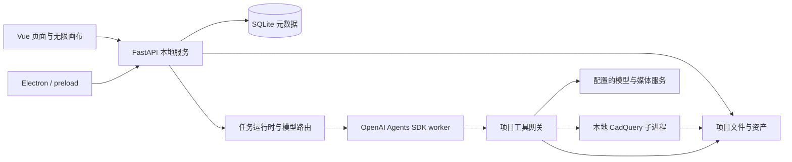

# 朗居设计Agent 架构

## 运行边界

Vue / Vue Router 提供首页、项目、资产、知识库、定时任务和账户页面；Electron preload 提供本地工作区及桌面能力。FastAPI 管理项目、任务、文件和 Provider，Node worker 通过 OpenAI Agents SDK 执行设计任务。

## 任务与模型

`TaskRuntime` 持久化任务、输入、输出、事件、取消及恢复状态；仅接受 `design` 任务。`ConversationContext` 从当前项目记录组装会话，跨项目引用在工具入口校验。`RoutedDesignRuntime` 按模型配置与任务复杂度选择模型。

简单问候使用一次轻量调用，默认 `openai/gpt-6-luna`，跳过知识检索、工具协作和交付检查。日常设计默认 `openai/gpt-6-luna`，不设置重复备用模型；其他请求使用任务策略和执行限制，必要时组织研究及检查。工具回执与检查点避免重试时重复提交已经完成的操作。

模型、Provider、Base URL 可配置；没有凭据或可用模型时明确报错。Key 只经过本机凭据边界，不写入数据库、画布、日志或导出。

## 画布与媒体

`CanvasStore` 保存项目节点、边和节点版本；前端增量更新保留并行 Agent 产生的节点。图片、视频、音频、3D 等资产保存文件、哈希、来源及模型元数据，再由节点引用。

媒体可以使用当前项目中的参考资产，也可以直接从提示词生成。视频异步任务保存在 `video_jobs`，后台查询并回填资产与画布；3D 任务保留 Provider Job ID 与 endpoint 以便刷新。媒体生成不依赖独立的 IP 确认步骤。

参数化 CAD 通过 `generate_cad` 使用本地 CadQuery / OpenCascade。Agent 与参数面板共用持久化构建服务；受限 AST 解释器在独立进程执行建模，检查实体和 STEP 回读，保存程序、参数、STEP/STL/GLB 及缩略图文件组。成功构建原子更新节点版本；参数重建不调用模型。详见 [本地 AI CAD](cad.md)。

`DeliveryService` 负责产物检查，浏览器 worker 验证 HTML 预览。`deliverable_export.py` 从选中的画布节点导出 HTML、PDF、PPTX、ZIP；导出与节点版本恢复独立于历史报告系统。

## 知识、项目与调度

项目上传资料和共享知识库分别索引。远程来源通过研究工具或来源导入保存可追溯快照；工具校验项目归属和联网设置。项目拥有自己的资产、资料、画布及版本文件，数据库存元数据而非媒体二进制。

`ScheduleService` 持久化计划、运行记录和通知，应用运行期间执行。停止或删除计划不会再触发新任务，运行中的任务保持独立状态。

## 验证

`npm run typecheck`、`npm test`、`npm run api:test` 和 `npm run build` 验证源码。后端测试使用临时工作区及模拟 Provider，不向真实模型提交付费请求。媒体、会话恢复、画布并发、简单问候路由、交付检查与定时任务均有独立覆盖。
