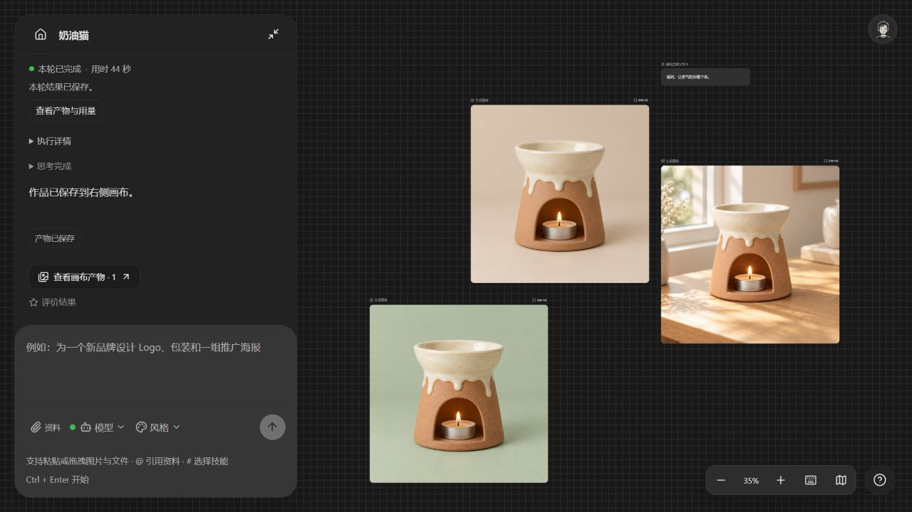
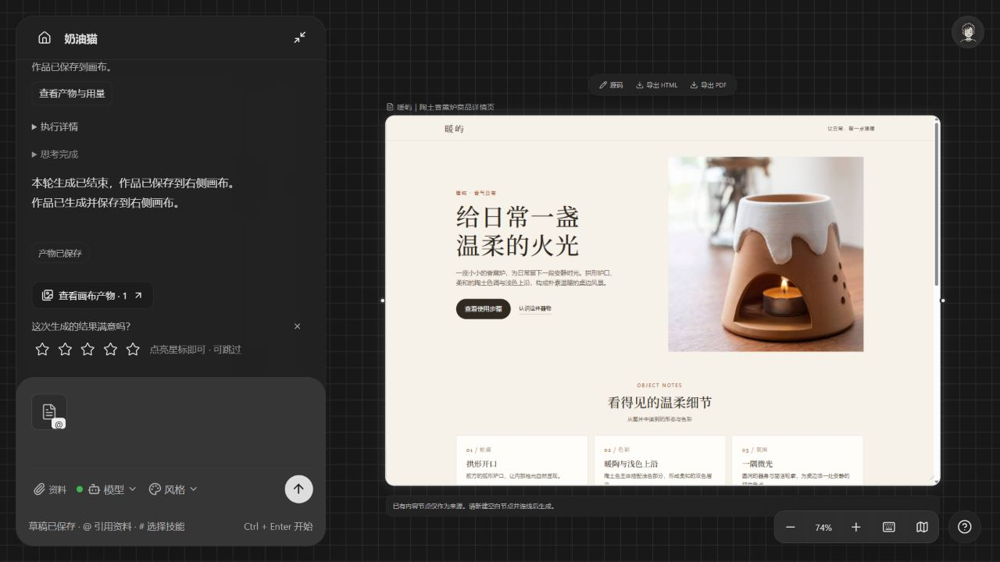
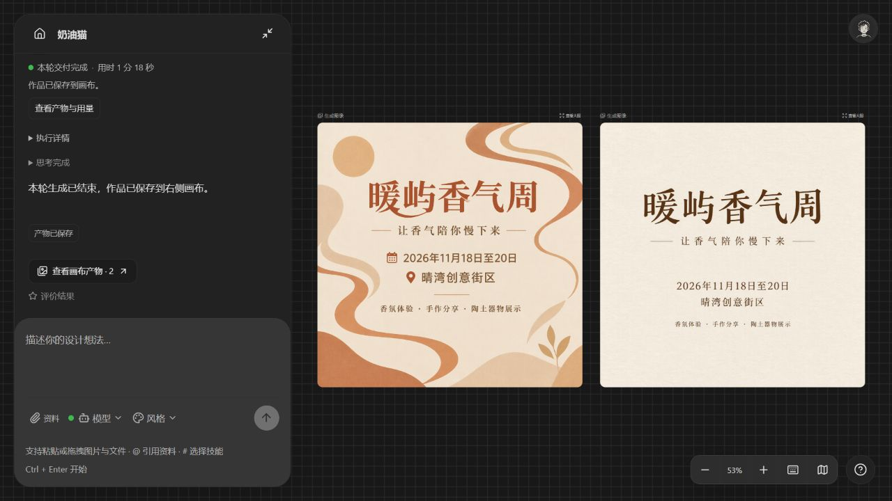

# 设计任务全链路实测 · 2026-10-22

运行版本：`design-sweep-20261022-v15`。使用浏览器中现有配置实际提交，保留全部测试项目、失败记录、原产物及计费账本。测试没有质量审查模型，也没有为未知收费请求自动重发。

## 结果

覆盖 12 类实际设计任务：Logo、IP 潮玩、产品主图与同款场景、图像局部编辑、包装、空间、文字策划、交互 HTML 详情页、文件驱动批量海报、语音、视频、参数化 CAD。修复后这些类型均取得实际产物；HTML 的 CSS 拼写错误在原节点本地修复，不重新调用模型。另验证了未配置 3D 专用服务时的前置拦截，未进行真实 3D 生成。

## 每次真实请求

耗时为任务创建至结束的实测墙钟时间，包含等待保存与预览；Token 为已返回的 SDK 输入与输出合计。费用仅列服务商已确认人民币扣费，空缺不代表免费。修改并重新提交保留前次失败记录。

| 任务 | 结果 | 文本调用 | 图像提交 | 耗时 | SDK Token | 已确认扣费 | 待对账 |
| --- | --- | ---: | ---: | ---: | ---: | ---: | ---: |
| [同款产品](http://127.0.0.1:5173/projects/2540b5d5-0c7e-416b-92f5-743d13bb5672) | 首次停在参考选择，已修复 | 2 | — | 38.0s | 34,207 | 待对账 | 3 |
| [Logo](http://127.0.0.1:5173/projects/cd0dd20d-8d14-49d2-8083-e2a4e49c9ecc) | 通过 | 2 | 1 | 42.0s | 34,598 | ¥0.0410 | 2 |
| [IP潮玩](http://127.0.0.1:5173/projects/2f78aaa2-4e04-4ac9-9c9a-2c7a09fb91ce) | 通过 | 1 | 1 | 37.1s | 3,748 | ¥0.0410 | 1 |
| [同款产品续接](http://127.0.0.1:5173/projects/2540b5d5-0c7e-416b-92f5-743d13bb5672) | 通过：2 图 + 文字卡 | 5 | 2 | 97.2s | 88,695 | ¥0.1350 | 5 |
| [参数化CAD](http://127.0.0.1:5173/projects/4ff9bd47-308b-4ba5-a76a-8f2862cbed0b) | 通过 | 2 | — | 27.0s | 32,663 | 待对账 | 2 |
| [语音](http://127.0.0.1:5173/projects/53e811ff-a316-4268-b845-682424b3c1d1) | 通过 | 2 | — | 34.0s | 30,108 | ¥0.0008 | 2 |
| [短视频](http://127.0.0.1:5173/projects/2a95bb0b-8116-4b1f-a27b-64de2e60d91e) | 通过 | 1 | — | 186.2s | 15,000 | ¥10.0450 | 1 |
| [文字策划](http://127.0.0.1:5173/projects/f616acbe-4fb9-4c26-9d8b-ae7e3f448a77) | 首次失败，后续已复验 | 5 | — | 29.7s | 77,071 | 待对账 | 5 |
| [文字策划](http://127.0.0.1:5173/projects/f616acbe-4fb9-4c26-9d8b-ae7e3f448a77) | 通过 | 5 | — | 25.3s | 69,550 | 待对账 | 5 |
| [包装设计](http://127.0.0.1:5173/projects/82bd09cc-a65f-469b-8a93-2466150ab798) | 通过 | 1 | 1 | 65.4s | 3,739 | ¥0.0940 | 1 |
| [空间设计](http://127.0.0.1:5173/projects/f108a4e1-d5b5-4014-95c3-de89c1f7163c) | 通过 | 1 | 1 | 38.2s | 3,729 | ¥0.0250 | 1 |
| [图像编辑](http://127.0.0.1:5173/projects/2540b5d5-0c7e-416b-92f5-743d13bb5672) | 通过 | 2 | 1 | 44.4s | 15,692 | ¥0.0920 | 2 |
| [HTML详情页](http://127.0.0.1:5173/projects/39fa83ff-e257-4ee9-8855-b013a5146189) | 首次失败，后续已复验 | 1 | — | 11.2s | 15,398 | 待对账 | 1 |
| [HTML详情页](http://127.0.0.1:5173/projects/39fa83ff-e257-4ee9-8855-b013a5146189) | 通过 | 4 | — | 260.7s | 68,451 | 待对账 | 4 |
| [3D模型](http://127.0.0.1:5173/projects/58f9da05-3392-4c8f-820b-e87e4d6f7045) | 配置拦截，未提交 | — | — | 0.1s | — | 未提交 | 0 |
| [资料海报批量](http://127.0.0.1:5173/projects/0cb262be-3377-4029-9b38-2a23efdb31c9) | 通过 | 7 | 2 | 79.0s | 126,011 | ¥0.0820 | 7 |

本轮累计已确认扣费 **¥10.5558**，另有 **42 笔待对账**；其中短视频按当前已配置的 Seedance 2.5 服务返回扣费 ¥10.045。待对账主要是文本调用，未用模型单价估算冒充真实扣款。

## 发现与修复

1. “不做研究”仍进入外部参考发现：修正否定意图，同时保留用户明确找参考和真实产品母图依赖。
2. “不调用图像”被算成需要图片：补齐否定动词，纯文字任务复测成功。
3. HTML 中复用的商品图被误算成新图片：在交付推断中区分素材与新产物，详情页复测只保存 HTML。
4. 记忆未选择时暴露写入工具导致无效调用：统一工具开放条件，并明确下一步选用动作；计划续接及文本/HTML 都受保护。
5. HTML 引用图片时缺省 output_mode 导致无效参数：图片与附件只能成为网页输入时本地补齐 create，已有网页编辑仍要求明确目标。
6. CSS 缺少一个右括号导致后续布局失效：原节点源码补齐括号；保存前增加本地结构校验，非法样式不覆盖原作。不是质量审查，不增加审查模型。
7. 异步视频不出现在请求检查面板：从 job 和最终交付记录读取产物标识，仍限制本项目。
8. 异步完成还显示等待和重复完成句：完成后清理系统生成的旧等待文案，旧记录仅规范化读取展示。

## 浏览器核验与边界

- 同款场景的实际 Provider 输入包含首图资产 `3d0c5066-6eb4-4bd7-8083-a5a6d1889797`；场景只生成一次。局部编辑仍引用此首图，保留原节点并保存绿色背景新图，无 403。
- Logo、IP、包装、空间和两张活动海报均实际打开并成功加载；活动名称、日期和地点来自上传文件。两张海报由 generate_batch 提交，每项一次。
- HTML 使用原始用户附件，不调用图像模型；步骤按钮滚动定位、FAQ 展开成功。修正 CSS 后原图片与栅格布局正常。
- 语音和 5 秒视频实际点击播放；CAD 显示 80×40×8mm 单一实体，槽 60×3×5mm，STEP 回读检查通过，STEP/STL/GLB 导出入口可用。
- 服务重启后健康检查返回 v15；浏览器重新打开视频的“已保存产物”可见生成视频，旧等待提示已清理。纯文字任务的 Markdown 内容也已打开核验。
- 3D 专用服务没有配置，预检返回 submitted=false、账本 0 条；此项不能标记为真实生成通过。
- 此矩阵验证当前配置下的主要生产链路，不等于遍历所有模型、任意提示词、复杂多页工程或发布环境。生成结果的设计质量仍由用户判断。

## 验证命令

- Python：需求/排除/参考/任务检查与交付 134 项通过；最终 HTML 语法、资产保存、SDK 与异步完成回归 101 项通过（83.12 秒）；HTML 引用目标定向测试 6 项通过。分组包含部分重复测试，不相加宣称独立用例总数。
- JavaScript：execution_efficiency / generation_batch / sdk_context 共 44 项通过。
- `npm run typecheck` 通过；两个修改的 Node 模块语法检查通过。
- 无新增第三方依赖；测试夹具修正 Windows file URI、UTF-8 以及已移除审查的旧断言。

## 截图

