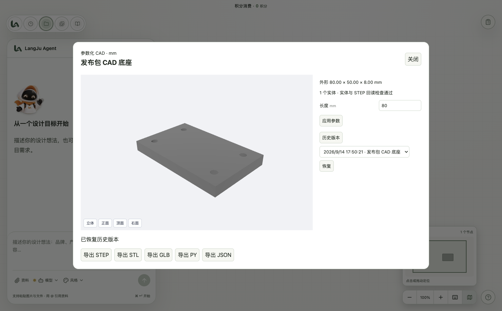

# 本地 AI CAD

在画布新增菜单选择「CAD 模型」，输入结构和尺寸（毫米），可上传参考图片。也可直接向 Agent 请求参数化 CAD 或 STEP 文件。已有 GPT 理解文字和图片，本机 CadQuery / OpenCascade 生成实体。



生成后点击节点上的「参数与导出」。修改参数并点击「应用参数」直接在本地重建，不调用 GPT；结构修改继续通过对话完成。详情中可查看假设、实体检查、历史版本，并导出 STEP、STL、GLB、Python 程序和参数 JSON。画布保存菜单可导出完整 ZIP 文件组。

STEP 用于交换实体，不包含原始建模历史。修改依赖项目保存的程序和参数；删除资产库条目会隐藏模型，但保留历史版本引用的文件。外部 STEP 改模、完整草图编辑和制造工程图不在本版范围内。

## 执行约定

`generate_cad` 和参数面板共用项目级 `POST /cad/builds`、`GET /cad/builds/{id}`、`POST /cad/builds/{id}/cancel`。基础路径为 `/api/projects/{projectId}`。`GET /api/cad/health` 返回运行时启动检查状态。

创建需要 `source`，修改需要 `canvas_node_id` 和从节点读取的 `base_revision`。省略 source 时使用该版本程序。`parameter_definitions` 支持 number/integer/boolean/enum、默认值、范围和单位；`expression` 是按定义顺序计算的只读派生参数。`parameters` 仅提交可编辑参数。`reference_asset_ids` 必须属于同一项目；`expected_dimensions` 为 x/y/z 外形尺寸，单位 mm。

```python
import cadquery as cq
result = cq.Workplane('XY').box(params['length'], 50, 8)
result = result.faces('>Z').workplane().pushPoints([
    [-30, -15], [30, -15], [-30, 15], [30, 15]
]).hole(5)
```

程序使用受限 Python 语法：局部赋值、数值运算、if、assert、有限 for/range、已登记的 CadQuery 构造器和方法。最终模型赋给 `result`。支持 `params.get`、有限数值的 `float`/`int` 转换、`len` 和最多 512 项的同类型列表/元组拼接；元组保持原类型，以兼容 CadQuery 的原生重载。尺寸间的关系可用 `assert 条件, '具体错误原因'` 检查。解释器不使用 exec/eval，不支持任意导入、属性反射、回调和文件操作；也不支持 try/except、函数定义、推导式、while 或增强赋值。完整程序在执行几何调用前做语法预检，一次报告多处问题，不能用 try/except 隐藏建模失败。可信宿主负责导出。限制为建模 120 秒、首次依赖加载 300 秒、2 GB 进程内存、64 个实体、20 万预览三角形，单文件最多 100 MB；阵列最多 512 项。原生几何进程崩溃或取消不会替换之前的可用模型。

真实生成用例保存在 `services/api/tests/fixtures/cad/`：`mounting_base.json` 为 200×120×12 mm、R10 外角、四个 Ø8 安装孔和中央 Ø30 孔，孔位随长宽和边距联动；`flared_cup.json` 为带圆弧杯腹、外扩杯口、中空内腔及圈足的闭合旋转截面。回归检查 STEP 回读后的实际孔径、孔位、圆角、体积，以及杯腔和圈足的材料分布。

构建检查实体有效性、体积、外形尺寸、指定尺寸和 STEP 回读一致性。GLB 经 Chromium 实际渲染三个视图，交给现有交付审查流程。几何检查不代替材料、装配公差或制造可行性审核。

CadQuery 2.8 的 Assembly GLB 导出已转换为 Y 轴向上，但保留毫米数值；可信导出层追加 0.001 场景缩放，让最终 GLB 遵循米制。STEP/STL 和参数仍使用毫米。模型清单及所有关联文件均按入库 SHA-256 校验，损坏文件不能通过交付检查。

## 开发与分发验证

- `uv sync --project services/api`：安装锁定依赖。
- `npm run typecheck`、`npm test`、`npm run api:test`：静态检查和自动化测试。
- `services/api/.venv/bin/python scripts/smoke-cad.py`：真实底座、外壳和旋转器具建模及导出。
- `node scripts/test-cad-preview.cjs`：Chromium 实际加载 GLB，检查毫米到米及坐标轴转换、三视图和损坏模型处理。
- `node scripts/test-cad-panel.cjs`：启动临时本地 API 和真实 Vue 面板，验证 80→100 mm 参数重建、版本恢复及不创建 Agent / 生成请求。
- `python scripts/smoke-cad.py --frozen /path/to/aics-api`：检查 Mac 冻结运行时。
- `node scripts/smoke-packaged-macos.mjs <app路径> --cad`：启动完整 Mac 应用的临时配置和工作区，验证包内 API、画布预览、参数重建、恢复与 ZIP 导出。
- 在 Windows 上运行安装目录的 `CAD-SMOKE.cmd`，使用包内 Python 验证原生建模与导出；不需要开发环境。

Mac 使用 PyInstaller，Windows 使用内置 Python 3.13 x64。两个打包流程均收集实际分发依赖的许可证。Windows 的 PE 架构/文件完整性检查不等同于在 Windows 上运行；发布记录必须区分二者。

## 2026-09-14 验证记录

- 完整后端回归：585 项通过，其中 CAD 测试 28 项，覆盖真实几何、参数、取消、进程终止、版本恢复、回执重放、非法代码和跨项目访问。
- 前端与调度测试：162 项通过；TypeScript / Vue 类型检查通过。
- Chromium GLB 实测：80×50×8 mm 底座世界坐标尺寸为 0.08×0.008×0.05 m，三个视图可渲染，损坏 GLB 被拒绝。
- 真实参数面板：80→100 mm 本地重建与恢复到 80 mm 通过，未请求 Agent 或模型生成接口。
- Mac Apple Silicon 应用包内冻结运行时：底座、外壳、旋转器具的实体、STEP 回读及全部文件导出通过。
- 最终 Mac 应用完整流程：使用包内 Electron / Python 和全新临时工作区，创建 CAD、实际画布预览、80→100 mm 重建、恢复与 ZIP 导出通过。测试未使用开发 Python 执行应用内建模。
- Windows 分发结构检查：778 个原生模块的 PE 架构通过；内置 Python、依赖、SDK、前端、ZIP CRC、运行诊断脚本和许可证均已检查。
- Windows x64 的原生系统运行验收尚待 Windows 环境完成。当前不声明已经完成 Windows 安装、预览、改参、恢复的全流程验收。
- GPT 文本与图片生成的实网调用未在自动化测试中执行；本次验证覆盖现有 Agent 的工具接入及真实 CAD 执行链路。

实现源码入口：`services/api/app/cad.py`（构建与版本提交）、`cad_program.py`（受限解释器）、`cad_worker.py`（实体与导出）、`cad_routes.py`（API）、`apps/renderer/src/components/CadPanel.vue`（参数与恢复）、`features/cadViewer.ts`（预览与三视图）。

### 2026-09-14 生成代码兼容性修复

实际失败日志为 `不允许调用 get`、`不支持语法：Name`（来自 `float`），发生在几何生成前。新增安全的参数取值、数值转换、列表拼接和完整语法预检，工具规范明确禁止吞掉异常，并要求按真实报错阶段说明问题。

- 后端 600 项全部通过，其中 CAD 43 项；受本机端口沙箱限制的 7 项已在允许本机端口的环境补跑通过。前端 162 项通过。
- 指定底座 STEP 回读确认：200×120×12 mm，1 个有效实体，体积 276074.867862 mm³；安装孔中心为 (±80, ±40) mm，孔径 8 mm，中央孔径 30 mm，四外角半径 10 mm。
- 分别修改长度、宽度和安装孔边距，四孔位置自动联动且保持对称；会导致孔越出边界的参数被拒绝。
- 圆弧杯体及圈足：95×95×85 mm，1 个有效实体；改参后实体和 STEP 回读仍通过。
- 两个实际 GLB 均完成三个视图的 Chromium 渲染。新 Mac 应用签名检查通过，包内冻结运行时再次完成指定底座的建模和全部导出。
